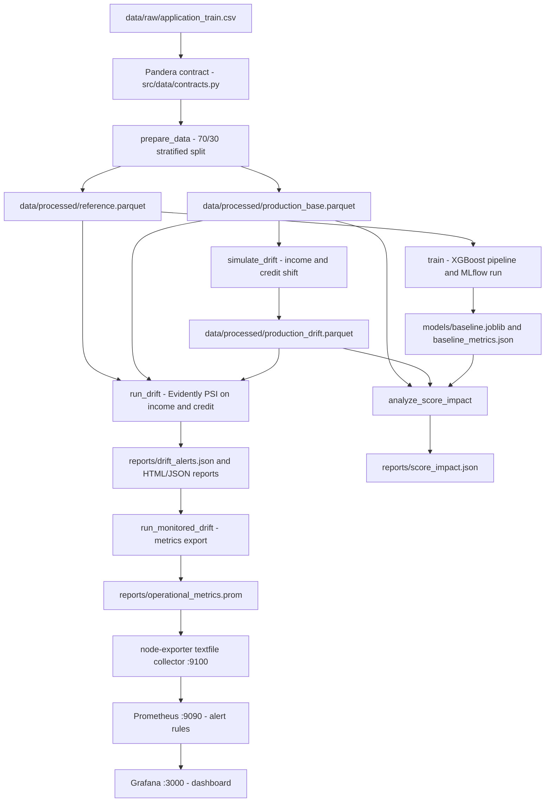

# System Architecture & Data/Model/Monitoring Flow

## Purpose and scope

The repository is a *Tech Challenge Fase 4* project (FIAP Pós-Tech in Machine Learning Engineering, written in Portuguese) about the **reliability and sustainment of an ML model**, not only about training one. The [README](../../README.md) frames the context this way: a fintech uses a credit-scoring model to estimate customers' default risk, and shifts in the served population or in economic conditions can change data distributions and therefore prediction behaviour. Beyond training a model, the team must validate input data, detect distribution changes, track operational indicators, and document limitations and risks.

The objectives listed in the README, and where each lives in the code, are:

| Objective (README) | Where it is implemented |
| :--- | :--- |
| Data-quality contracts with Pandera | `src/data/contracts.py` |
| XGBoost credit-scoring baseline tracked in MLflow | `src/features/build.py`, `src/models/baseline.py`, `src/training/train.py` |
| Drift simulation and detection with Evidently | `src/data/simulate_drift.py`, `src/pipelines/drift_monitor.py` |
| Impact of drift on model predictions | `src/pipelines/score_impact.py` |
| Structured logs, Prometheus metrics, Grafana dashboard | `src/monitoring/`, `infra/observability/`, `compose.observability.yaml` |
| Automatic alert rules for data drift and collector downtime | `infra/observability/prometheus/alerts.yml` |
| Governance, privacy/LGPD and model limitations documentation | README sections and `docs/` (documentation only) |

The dataset is **Home Credit Default Risk** (`application_train.csv` from Kaggle). Raw data, processed datasets and trained models are local artifacts and are intentionally not pushed to GitHub; the raw CSV is tracked by DVC by hash only, and no DVC remote is configured yet.

## Package boundaries

All production code lives under [`src/`](../../src/). Modules communicate through plain pandas DataFrames, files on disk, and a handful of shared constants.

| Package | Responsibility | Notes |
| :--- | :--- | :--- |
| [`src/data/`](../../src/data/) | `home_credit.py` loads only `RAW_COLUMNS` from the raw CSV and does a stratified reference/production split. `contracts.py` holds the Pandera schemas. `simulate_drift.py` creates controlled drift. | `load_application_train()` raises `FileNotFoundError` with the Kaggle URL if `data/raw/application_train.csv` is absent. |
| [`src/features/`](../../src/features/) | `build.py` defines column groups (`CATEGORICAL`, `NUMERIC_RAW`, `DERIVED`, `MODEL_FEATURES`, `RAW_COLUMNS`) and the stateless `build_features()` transform. | `CODE_GENDER` is read only for bias analysis and is not a model feature. |
| [`src/models/`](../../src/models/) | `baseline.py` builds the scikit-learn pipeline (features, ordinal encoding, `XGBClassifier`) and handles persistence and scoring. | Persists `models/baseline.joblib` and `models/baseline_metrics.json`. |
| [`src/training/`](../../src/training/) | `train.py` validates the reference set, trains with a stratified 20% hold-out, evaluates, and logs to MLflow. | Experiment name `credit-scoring-baseline`. |
| [`src/pipelines/`](../../src/pipelines/) | `prepare_data.py` (raw to contract to reference/production), `drift_monitor.py` (Evidently PSI report and alert extraction), `score_impact.py` (before/after score comparison). | Reusable logic that the `scripts/` entrypoints call. |
| [`src/monitoring/`](../../src/monitoring/) | `metrics.py` (Prometheus metrics), `logging_config.py` (JSON logs), `validation.py` (Pandera validation wrapped with logs and metrics). | See [Observability Stack](../operations/observability_stack.md). |
| [`src/utils/`](../../src/utils/) | `config.py` exposes the `settings` singleton. | See [Configuration and Environment](../concepts/configuration_and_environment.md). |
| [`src/api/`](../../src/api/) | Placeholder package; its `__init__.py` contains only a docstring. | The README lists it as "API components" and `docs/architecture.md` draws an API box, but no serving code exists yet. |

[`src/main.py`](../../src/main.py) is **not** an orchestrator: its `main()` only prints "Projeto inicializado com sucesso." The real entrypoints are the module commands (`python -m src.pipelines.prepare_data`, `python -m src.training.train`) and the files under `scripts/`.

### Scripts layer

[`scripts/`](../../scripts/) holds thin operational entrypoints that read or write artifacts and delegate to `src/`:

- `validate_home_credit.py` validates the raw CSV against the training contract.
- `simulate_home_credit_drift.py` builds `production_drift.parquet` (80% of rows, income multiplied by 1.80 and credit by 1.70, seed 42) and checks it against the inference contract (without `TARGET`).
- `run_drift.py` produces the baseline and simulated drift reports and `reports/drift_alerts.json`.
- `analyze_score_impact.py` writes `reports/score_impact.json`.
- `run_monitored_drift.py` combines loading, monitored validation, drift detection and Prometheus export.
- `demo_invalid_batch.py`, `inspect_home_credit.py` and `check_notebooks.py` are demonstration, exploration and CI-hygiene helpers.

## End-to-end flow: raw data to alert

*Figure 1: Artifact flow from the raw Home Credit CSV through contracts, preparation, training, drift, score impact and the Prometheus/Grafana stack.*

1. **Contracts.** `validate_training_batch` runs a lazy Pandera validation (`lazy=True`, so all violations are collected) on a deliberately small subset of columns; `strict=False` means other columns pass unchecked. See [Data Contracts](../concepts/data_contracts.md).
2. **Prepare.** `prepare_data.run()` validates the raw frame first, so a violation raises `SchemaErrors` and **nothing is written**. It then splits 70% reference and 30% production, stratified on `TARGET` with `settings.random_seed`, and writes both as **raw columns** (no engineered features) to `data/processed/`. Keeping raw columns is deliberate: feature engineering lives inside the model pipeline, so simulated changes to income or credit propagate into derived ratios such as `CREDIT_INCOME_RATIO`.
3. **Train.** `src/training/train.py` re-validates the reference set, trains `build_pipeline()` (unknown categories become `NaN`, which XGBoost handles natively), computes AUC, KS, PR-AUC and F1 at the best-F1 threshold, adds AUC per gender and age band (groups below 30 positives are skipped), and logs params, metrics and the model to MLflow (default SQLite `mlflow.db`). It also saves the joblib model and a metrics JSON that carries the decision `threshold` later used by score impact. See [ML Pipeline and Tracking](../workflows/ml_pipeline_and_tracking.md).
4. **Drift.** `generate_drift_report` samples up to 5,000 rows from each side (seed 42) and runs Evidently's `DataDriftPreset` with `method="psi"` and `threshold=0.2` on only `AMT_INCOME_TOTAL` and `AMT_CREDIT`, writing HTML plus JSON. `extract_psi_alerts` turns each `ValueDrift` metric into `{psi, threshold, alert}` with `alert = psi >= threshold` and fails if no PSI metric is found. `run_drift.py` compares reference against both the unchanged production base (`baseline`) and the drifted base (`simulated`).
5. **Score impact.** `compare_prediction_scores` requires non-empty frames, unique non-null `SK_ID_CURR` values and the same set of customers in both bases, scores both with the saved model, and joins one-to-one by ID. The summary reports mean scores, mean absolute change, share above threshold and how many decisions crossed the threshold. It measures behavioural change, not proven performance degradation. See [Drift Monitoring and Score Impact](../workflows/drift_monitoring_and_score_impact.md).
6. **Metrics export.** `run_monitored_drift.py` creates an isolated `CollectorRegistry`, wraps loading (`data_loading`), validation (`data_validation`) and drift (`drift_monitor`) in `observe_pipeline`, records the **simulated** PSI per feature into the `credit_data_drift_psi` gauge, and in a `finally` block always writes `reports/operational_metrics.prom` - even when a stage failed, in which case `credit_pipeline_runs_total{status="error"}` is exported.
7. **Alerting.** `node-exporter` reads `./reports` read-only as a textfile directory; Prometheus scrapes it every 10 s (job `credit_scoring`) and evaluates `CreditScoringDataDrift` (`credit_data_drift_psi >= 0.20` for 30 s, warning) and `CreditScoringExporterDown` (`up == 0` for 1 min, critical). Grafana provisions a Prometheus datasource and the `credit-scoring-observability` dashboard from the repository.

### Monitoring signals

| Signal | Type | Produced by |
| :--- | :--- | :--- |
| `credit_pipeline_runs_total{pipeline,status}` | Counter | `observe_pipeline` (`success` or `error`) |
| `credit_pipeline_duration_seconds` | Histogram | `observe_pipeline` |
| `credit_data_drift_psi{feature}` | Gauge | `record_psi` (rejects non-finite or negative values) |
| JSON log events (`event`, `status`, `records`, `pipeline`, `error_type`) | Structured logs | `validate_training_with_monitoring` via `configure_json_logging` |

A Pandera rejection logs `status=rejected` but increments the run counter with `status=error`. Logs deliberately omit individual customer values.

Because metrics are written by a short-lived Python process, counters describe the **last exported run**, not a long-running service. Python runs locally through `uv`; Docker Compose starts only the observability services and neither trains the model nor schedules the drift script.

## DVC pipeline and artifacts

[`dvc.yaml`](../../dvc.yaml) declares six stages in README order: `validate`, `prepare_data`, `train`, `simulate_drift`, `detect_drift`, `score_impact`. Dependencies mirror the data flow (for example `train` depends on `reference.parquet`, `src/features`, `src/models`, `src/training`). `run_monitored_drift.py` is **not** a DVC stage, so `operational_metrics.prom` is produced manually. Metrics files (`baseline_metrics.json`, `drift_alerts.json`, `score_impact.json`) are declared with `cache: false` so `dvc metrics show` reads them directly, and `dvc.lock` should be committed with changes.

| Location | Contents |
| :--- | :--- |
| `data/raw/` | Kaggle CSV (DVC-tracked hash only) |
| `data/processed/` | `reference.parquet`, `production_base.parquet`, `production_drift.parquet` |
| `models/` | `baseline.joblib`, `baseline_metrics.json` |
| `reports/` | Evidently HTML/JSON, `drift_alerts.json`, `score_impact.json`, `operational_metrics.prom` |
| `mlflow.db` | Default local MLflow tracking store |

## Infrastructure

[`compose.observability.yaml`](../../compose.observability.yaml) defines `node-exporter` (textfile collector only, defaults disabled), `prometheus` (7-day retention, mounted `prometheus.yml` and `alerts.yml`) and `grafana` (provisioned from `infra/observability/grafana/`). All ports are bound to `127.0.0.1` (9100, 9090, 3000), and Grafana refuses to start unless `GRAFANA_ADMIN_PASSWORD` is set. Details are in [Observability Stack](../operations/observability_stack.md).

The PSI threshold exists in two places that must be kept in sync: `PSI_THRESHOLD = 0.2` in `src/pipelines/drift_monitor.py` and the `0.20` literal in `alerts.yml`.

## Configuration

`src/utils/config.py` defines a Pydantic `Settings` class loaded from the repository-root `.env` (unknown keys ignored) with defaults for `env`, `log_level`, `random_seed` (42), `mlflow_tracking_uri` (`sqlite:///<ROOT>/mlflow.db`), `data_dir` and `models_dir`. Data, model and MLflow locations all resolve through `settings`, which is why the same code runs unchanged across environments. One exception: `scripts/run_drift.py` and `scripts/analyze_score_impact.py` compute `REPORT_DIR` from the file location, so `reports/` is not configurable, and `drift_monitor.py` uses its own constant seed 42 rather than `settings.random_seed`. See [Configuration and Environment](../concepts/configuration_and_environment.md).

## Quality gates and invariants

- Production logic lives only in `src/`; notebooks under `notebooks/` are exploratory and must be committed without outputs, enforced by `scripts/check_notebooks.py` in pre-commit and CI.
- CI (`.github/workflows/ci.yml`) runs Ruff lint and format checks, the notebook check, Radon and a Xenon complexity gate on `src` (`--max-absolute B --max-modules A --max-average A`), then Pytest with coverage. The Docker image job is disabled (`if: false`) until a Dockerfile exists.
- Unit tests in `tests/unit/` cover the contracts, features, baseline, prepare step, drift monitor, score impact, metrics, logging and monitored-drift script; `tests/integration/` is empty apart from `__init__.py`.
- Reproducibility depends on `random_seed` for the split, hold-out and XGBoost, plus the fixed seed 42 in drift sampling and simulation.

## Known limits

- No serving layer: the README and `docs/architecture.md` anticipate an API after MLflow, but `src/api/` is empty.
- The "production" base is a random split of the historical data, not a later time period.
- Only two variables are drift-monitored, on 5,000-row samples; the PSI threshold of 0.20 is a convention rather than a universal rule.
- The contract checks only seven feature columns plus `TARGET` (eight of the 122 columns in the source file), so most model inputs are unvalidated.

## Related pages

- [Configuration and Environment](../concepts/configuration_and_environment.md)
- [Data Contracts](../concepts/data_contracts.md)
- [ML Pipeline and Tracking](../workflows/ml_pipeline_and_tracking.md)
- [Drift Monitoring and Score Impact](../workflows/drift_monitoring_and_score_impact.md)
- [Observability Stack](../operations/observability_stack.md)
- [Quickstart Guide](../quickstart.md)
- [Architecture sketch in docs/](../../docs/architecture.md)
