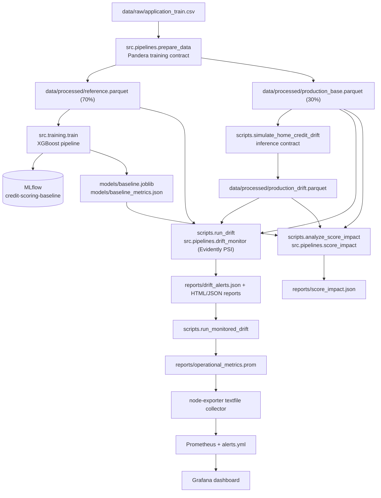

# Architecture Overview

## Project context and objective

The project is the FIAP Post-Tech Machine Learning Engineering "Tech Challenge Fase 4" (observability, data drift and model governance). Its scenario is a fintech that uses a *Credit Scoring* model to estimate customers' default risk. Shifts in the served population or in economic conditions can change data distributions and therefore prediction behaviour ([README](../../README.md), "Contexto").

Training a model is therefore not enough. The input data must be validated, distribution changes identified, operational indicators tracked, and limitations and risks documented. The stated objective is a **sustainment and reliability solution for ML models**: data-quality contracts (Pandera), an XGBoost baseline tracked in MLflow, drift simulation and detection (Evidently), analysis of drift impact on predictions, observability (structured logs, Prometheus metrics, Grafana dashboard), automatic alert rules (data drift and collector unavailability), and governance/LGPD documentation. The **Home Credit Default Risk** dataset (`application_train.csv`) is the basis for development and simulation.

## System map

Everything is orchestrated by command-line modules run with `uv run python -m ...`; the Docker Compose stack is needed only for the observability layer.

## Responsibilities by layer

| Layer | Location | Responsibility |
| :--- | :--- | :--- |
| Data contracts and loading | `src/data/` | `contracts.py` defines Pandera schemas, `home_credit.py` loads the CSV and splits reference/production, `simulate_drift.py` produces controlled drift. |
| Feature engineering | `src/features/build.py` | Stateless `build_features` that derives ratios, age and treats the `DAYS_EMPLOYED` sentinel. |
| Model | `src/models/baseline.py` | scikit-learn `Pipeline` (features, ordinal encoding, XGBoost), persistence and `score()`. |
| Training | `src/training/train.py` | Hold-out training, evaluation, group metrics and MLflow logging. |
| Pipelines | `src/pipelines/` | `prepare_data` (raw to contract to reference/production), `drift_monitor` (Evidently PSI), `score_impact` (before/after drift predictions). |
| Monitoring | `src/monitoring/` | Prometheus metric definitions, JSON logging, monitored validation. |
| Operational scripts | `scripts/` | Thin runnable entrypoints that wire the layers together and write `reports/`. |
| Configuration | `src/utils/config.py` | `Settings` (Pydantic) reading `.env`. |
| Observability infra | `compose.observability.yaml`, `infra/observability/` | Node Exporter, Prometheus, Grafana provisioning and alert rules. |

The package layout under `src/` is `data`, `features`, `models`, `training`, `pipelines`, `monitoring`, `api` and `utils` ([README](../../README.md), "Estrutura do projeto"). `src/api/` currently contains only an empty `__init__.py`, so no prediction-serving API exists yet. `src/main.py` is a placeholder that only prints "Projeto inicializado com sucesso."; it does not orchestrate pipelines. The effective entrypoints are the modules listed above. [docs/architecture.md](../../docs/architecture.md) shows a simplified, aspirational flow (`data/raw` to `src/data` to `src/features` to `src/training` to MLflow to `src/api`) that does not match the implemented drift/observability work.

## Data contracts

`src/data/contracts.py` defines `credit_schema(training=True|False)`. Columns include `SK_ID_CURR` (unique int), positive `AMT_INCOME_TOTAL`/`AMT_CREDIT`, nullable positive `AMT_ANNUITY`, `DAYS_BIRTH <= -6575` (age at least 18), non-negative `CNT_CHILDREN` and `NAME_INCOME_TYPE`. The training schema additionally requires a binary `TARGET`. Schemas are `strict=False`, `coerce=False`, and validated lazily so all violations are reported together.

Contracts are enforced at three points: `prepare_data.run()` (an invalid raw batch raises `SchemaErrors` and nothing is written), `train.main()` (reference re-validated before training) and `simulate_home_credit_drift` (inference contract, without `TARGET`, on the drifted data). `score()` does **not** validate on each call; the README flags this as future work for an inference interface.

## Training and tracking

`prepare_data` persists *raw* columns only, deliberately: feature engineering lives inside the model pipeline, so simulated changes to raw columns such as income propagate into derived ratios. `split_reference_production` is stratified on `TARGET` using `settings.random_seed` (70% reference / 30% production).

`train.main()` reads `reference.parquet`, validates it, holds out a stratified 20%, fits the pipeline and computes AUC, KS, PR-AUC and F1 at the F1-optimal threshold, plus AUC by gender and age group (groups with fewer than 30 positives are skipped; `CODE_GENDER` is used only for this bias analysis, never as a feature). It logs parameters, metrics and the model to the MLflow experiment `credit-scoring-baseline` and also saves `models/baseline.joblib` and `models/baseline_metrics.json`. The saved threshold is later read by `load_threshold()` for score-impact analysis. Unknown categories at inference become `NaN`, which XGBoost handles natively. See [ML Pipeline and Tracking](../workflows/ml_pipeline_and_tracking.md) for the workflow.

## Drift monitoring and score impact

- **Simulation**: `simulate_income_credit_drift` copies the data and multiplies `AMT_INCOME_TOTAL` and `AMT_CREDIT` for a random fraction of rows (the script uses 80% of rows, x1.80 income and x1.70 credit, seed 42).
- **Detection**: `generate_drift_report` checks required columns and non-empty inputs, samples up to 5,000 rows per side and runs Evidently `DataDriftPreset` with PSI on `AMT_INCOME_TOTAL` and `AMT_CREDIT`, writing HTML and JSON. `extract_psi_alerts` marks a column as alert when PSI >= 0.2 and fails if no PSI metric is found. `scripts.run_drift` compares reference against both the unchanged production base ("baseline") and drifted data ("simulated"), writing `reports/drift_alerts.json`.
- **Score impact**: `compare_prediction_scores` requires non-empty frames with identical, unique, non-null `SK_ID_CURR` sets and a threshold strictly between 0 and 1. It scores both datasets, joins one-to-one by ID and summarises mean scores, mean absolute change, share above threshold and number/percent of decisions that crossed the threshold. `scripts.analyze_score_impact` writes `reports/score_impact.json`.

## Observability stack

`scripts.run_monitored_drift` loads the data, validates it via `validate_training_with_monitoring`, runs the drift script, records the PSI of the *simulated* scenario in the `credit_data_drift_psi{feature}` gauge, and in a `finally` block always writes `reports/operational_metrics.prom` using a dedicated `CollectorRegistry`. `observe_pipeline` wraps stages and updates `credit_pipeline_runs_total{pipeline,status}` and `credit_pipeline_duration_seconds{pipeline}`; `record_psi` rejects non-finite or negative values. Validation outcomes are logged as JSON (`approved`, `rejected`, `error`) by `JsonFormatter` through the non-propagating `credit_scoring` logger.

There is no long-running application exporter: the metrics file is a batch artifact. `compose.observability.yaml` mounts `reports/` read-only into Node Exporter's textfile collector (default collectors disabled), Prometheus scrapes `node-exporter:9100` every 10 s as job `credit_scoring` (7-day retention), and Grafana (port 3000, sign-up disabled, admin password required through `GRAFANA_ADMIN_PASSWORD`) is provisioned with the Prometheus datasource and the `credit-scoring-observability` dashboard. Ports are bound to `127.0.0.1`. `alerts.yml` defines `CreditScoringDataDrift` (`credit_data_drift_psi >= 0.20` for 30 s, warning) and `CreditScoringExporterDown` (`up{job="credit_scoring"} == 0` for 1 m, critical). Because data only changes when the script is re-run, stale metrics persist until the next run.

## Configuration and quality gates

`Settings` in `src/utils/config.py` reads `.env` at the repository root (extra keys ignored) with defaults `env=local`, `log_level=INFO`, `random_seed=42`, `mlflow_tracking_uri=sqlite:///<root>/mlflow.db`, `data_dir=<root>/data`, `models_dir=<root>/models`. Details in [Configuration and Environment](../concepts/configuration_and_environment.md).

CI (`.github/workflows/ci.yml`) runs Ruff lint/format, `scripts/check_notebooks.py` (notebooks without outputs), Radon and a Xenon complexity gate on `src`, then Pytest with coverage; the Docker image job is disabled (`if: false`) until a Dockerfile exists. Unit tests under `tests/unit/` cover contracts, features, baseline, prepare_data, drift simulation/monitor, score impact, metrics, JSON logging and monitored validation. Raw data, processed datasets and trained models are local artifacts and must not be committed. See [Test Suite and CI](../testing/test_suite_and_ci.md) and [Quickstart](../quickstart.md).
