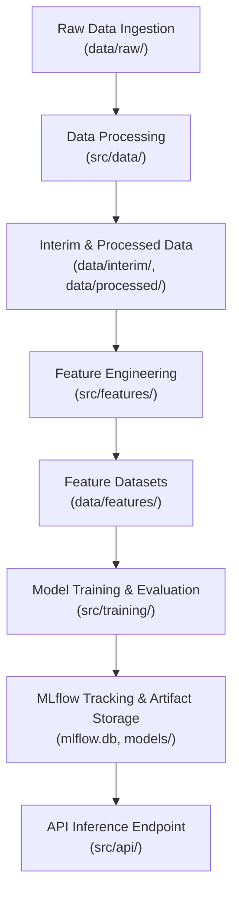

# System Architecture & ML Pipeline Design

The repository is structured as a production-grade machine learning project, maintaining a clear separation of concerns across raw data storage, feature transformations, model definitions, training execution, MLflow experiment tracking, and prediction API serving.

The production source codebase is organized under the [`src/`](../../src/) package directory, enforcing modularity, standard coding conventions, and explicit component responsibilities across the ML lifecycle.

---

## Component Boundaries & Module Responsibilities

The production package under [`src/`](../../src/) is partitioned into distinct submodules, each responsible for a single stage or concern within the machine learning pipeline:

| Module Path | Core Responsibility | Key Touchpoints & Storage |
| :--- | :--- | :--- |
| [`src/data/`](../../src/data/) | Raw data ingestion, validation, and staging into intermediate formats. | [`data/raw/`](../../data/raw/), [`data/interim/`](../../data/interim/), [`data/processed/`](../../data/processed/) |
| [`src/features/`](../../src/features/) | Feature engineering, transformation logic, and feature store generation. | [`data/features/`](../../data/features/) |
| [`src/models/`](../../src/models/) | Machine learning model architectures, custom wrappers, and prediction interfaces. | [`models/`](../../models/) directory |
| [`src/training/`](../../src/training/) | Model training routines, cross-validation, metric evaluations, and MLflow tracking integration. | MLflow backend tracking database and model artifacts |
| [`src/pipelines/`](../../src/pipelines/) | End-to-end pipeline composition orchestrating data processing, feature engineering, training, and evaluation workflows. | Called via entrypoints such as [`src/main.py`](../../src/main.py) |
| [`src/api/`](../../src/api/) | REST API / web serving interface for online inference and model predictions. | Inference request handlers |
| [`src/utils/`](../../src/utils/) | Shared system utilities, logger setup, and centralized configuration loading. | [`src/utils/config.py`](../../src/utils/config.py) |

---

## Data Flow & Pipeline Architecture

The overall system architecture follows a linear, staged processing flow. Raw data is ingested, transformed through progressive staging directories, converted into engineered features, trained into models logged to MLflow, and ultimately served via an inference API.


*Figure 1: End-to-end data processing, training, experiment tracking, and model serving workflow.*

---

## Centralized Configuration Management

Runtime configuration and environmental parameters are managed through Pydantic Settings in [`src/utils/config.py`](../../src/utils/config.py). The `Settings` class automatically loads key-value pairs from the `.env` file located at the repository root and exposes strongly-typed configuration settings.

Key configuration attributes provided by `Settings` include:

- `env`: Specifies the execution environment (e.g., `local`, `dev`, `prod`).
- `log_level`: Defines logging verbosity (e.g., `INFO`, `DEBUG`).
- `random_seed`: Ensures reproducibility across random seed initializations (default: `42`).
- `mlflow_tracking_uri`: Sets the MLflow tracking backend URL (default: `sqlite:///<ROOT_DIR>/mlflow.db`).
- `data_dir`: Base directory for data stages (default: `<ROOT_DIR>/data`).
- `models_dir`: Target directory for saved trained model artifacts (default: `<ROOT_DIR>/models`).

---

## Execution Entrypoint & Pipeline Execution

Pipeline orchestration begins at [`src/main.py`](../../src/main.py), which serves as the primary executable entrypoint. Calling `main()` initializes runtime configurations via `src.utils.config.settings` and executes pipeline stages defined within [`src/pipelines/`](../../src/pipelines/).

```python
# Execution pattern represented in src/main.py
def main() -> None:
    """Executa o pipeline principal."""
    print("Projeto inicializado com sucesso.")
```

---

## Architectural Invariants & Quality Standards

To maintain high code quality, modular separation, and system reliability, the codebase enforces several automated checks and architectural invariants:

1. **Separation of Concerns**: Exploratory code is isolated in `notebooks/exploratory/` and `notebooks/reports/`, while production logic resides exclusively under `src/`.
2. **Clean Notebook Constraint**: Notebooks committed to Git must be stripped of execution outputs and cell execution counts. This invariant is enforced by `scripts/check_notebooks.py` during pre-commit and CI runs.
3. **Complexity & Style Enforcements**: Code in `src/` must pass strict Ruff linting and formatting standards, Pytest suite runs, and Radon/Xenon cyclomatic complexity thresholds (enforced via `.github/workflows/ci.yml`).
4. **Reproducibility**: Experiments and data transformations rely on `random_seed` configured in `Settings` to ensure repeatable execution runs across environments.

---

## Related Documents & Further Reading

- [Configuration and Environment](../concepts/configuration_and_environment.md) – Detailed guide to environment variables, `.env` file handling, and Pydantic Settings.
- [Quickstart Guide](../quickstart.md) – Instructions for setting up local development environments, running tests, and executing pipelines.
- [ML Pipeline and Tracking](../workflows/ml_pipeline_and_tracking.md) – Workflow details covering pipeline stages, MLflow experiment tracking, and model artifact management.
- [Architecture Blueprint Document](../../docs/architecture.md) – High-level architectural flowchart from the design documentation.
