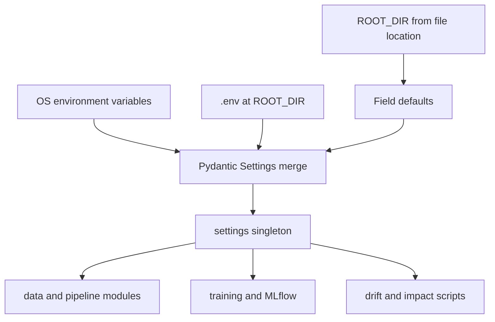

# Environment Configuration & Settings Management

Configuration in this repository is deliberately small. One Pydantic Settings class in [`src/utils/config.py`](../../src/utils/config.py) owns the runtime knobs (environment name, log level, random seed, MLflow URI, data and model directories). Everything else is tooling configuration: the Python/uv toolchain pins in `pyproject.toml` and `.python-version`, DVC settings under `.dvc/`, and a handful of paths and environment variables used by the local observability stack.

---

## Runtime settings (`src/utils/config.py`)

### Root anchor

```python
ROOT_DIR = Path(__file__).resolve().parents[2]
```

`__file__` is `src/utils/config.py`, so `parents[2]` is the repository root. Every default path is built from this anchor, so behavior does not depend on the current working directory (pytest from the root, `python -m scripts.*`, notebooks).

### The `Settings` model

```python
class Settings(BaseSettings):
    model_config = SettingsConfigDict(env_file=ROOT_DIR / ".env", extra="ignore")

    env: str = "local"
    log_level: str = "INFO"
    random_seed: int = 42
    mlflow_tracking_uri: str = f"sqlite:///{ROOT_DIR / 'mlflow.db'}"
    data_dir: Path = ROOT_DIR / "data"
    models_dir: Path = ROOT_DIR / "models"

settings = Settings()
```

| Field | Environment variable | Default | Role |
| :--- | :--- | :--- | :--- |
| `env` | `ENV` | `local` | Environment identifier. |
| `log_level` | `LOG_LEVEL` | `INFO` | Level passed to `logging.basicConfig` by the pipeline entrypoints. |
| `random_seed` | `RANDOM_SEED` | `42` | Seed for the train/test split and the model pipeline in training, and for the production split in data preparation. |
| `mlflow_tracking_uri` | `MLFLOW_TRACKING_URI` | SQLite file `mlflow.db` at `ROOT_DIR` | Passed to `mlflow.set_tracking_uri` in training. |
| `data_dir` | `DATA_DIR` | `ROOT_DIR/data` | Parent of `raw/` and `processed/`. |
| `models_dir` | `MODELS_DIR` | `ROOT_DIR/models` | Where the baseline model and metrics are written. |

Key behaviors:

- **Precedence**: real OS environment variables win, then the `.env` file at `ROOT_DIR`, then the field defaults.
- **`extra="ignore"`**: unknown keys in `.env` (for example Grafana-related values someone adds) do not cause validation errors.
- **Singleton at import time**: `settings = Settings()` is created when the module is first imported, so environment changes after import are not picked up. Code and tests therefore override attributes on the shared object rather than re-reading the environment.
- **Typed validation**: `RANDOM_SEED` must parse as an integer and the directories are coerced to `Path`; invalid values fail at import.

### `.env.example` and secrets

[`.env.example`](../../.env.example) is the template (`cp .env.example .env`) and lists `ENV`, `LOG_LEVEL`, `RANDOM_SEED` and `MLFLOW_TRACKING_URI`. `.env` itself is git-ignored (`# Segredos` in `.gitignore`) and excluded from Docker contexts by `.dockerignore`.

Note the template sets `MLFLOW_TRACKING_URI=sqlite:///mlflow.db`, a relative SQLite path, whereas the code default is an absolute path under `ROOT_DIR`. If you copy the template unchanged, the database location follows the process working directory instead of the repository root; delete the line (or use an absolute URI) to keep the anchored default. `mlflow.db`, `mlruns/` and `mlartifacts/` are all git-ignored.

### Who consumes settings

| Consumer | Settings used |
| :--- | :--- |
| `src/data/home_credit.py` | `data_dir` (raw CSV under `data/raw/`) |
| `src/pipelines/prepare_data.py` | `data_dir`, `random_seed`, `log_level` |
| `src/training/train.py` | `random_seed`, `data_dir`, `mlflow_tracking_uri`, `log_level` |
| `src/models/baseline.py` | `models_dir` (created on demand when saving) |
| `scripts/run_drift.py`, `scripts/simulate_home_credit_drift.py`, `scripts/analyze_score_impact.py` | `data_dir / "processed"` |

Not everything routes through settings: the drift and score-impact scripts compute their own `REPORT_DIR` as `<repo>/reports` from `__file__`, and the JSON logger (below) hard-codes its level.


*Figure 1: Precedence (OS, then .env, then defaults) and the singleton shared by pipeline code.*

### Testing

[`tests/unit/test_smoke.py`](../../tests/unit/test_smoke.py) asserts `settings.random_seed == 42` and `settings.data_dir.name == "data"`. Other unit tests isolate filesystem state by patching the shared object, e.g. `monkeypatch.setattr(baseline.settings, "models_dir", tmp_path)` in `test_baseline.py` and `monkeypatch.setattr(home_credit.settings, "data_dir", tmp_path)` in `test_prepare_data.py`. Because modules import the same `settings` instance, patching one module's reference affects all.

---

## Toolchain: Python version and uv

- [`.python-version`](../../.python-version) pins `3.12`; `pyproject.toml` declares `requires-python = ">=3.12"` and Ruff targets `py312`.
- Dependencies are managed with `uv` and `uv.lock`. Runtime dependencies include `pydantic-settings`, `mlflow`, `prometheus-client`, `evidently`, `pandera`, `scikit-learn` and `xgboost`; the `dev` dependency group holds `dvc`, `pytest`, `pytest-cov`, `ruff`, `radon`, `xenon`, `pre-commit`, `nbstripout` and `ipykernel`.
- Local setup uses `uv sync --locked` (README); CI runs `uv python install` then `uv sync --frozen` before linting and tests (see [`.github/workflows/ci.yml`](../../.github/workflows/ci.yml)). The DVC stage commands are all written as `uv run python -m ...`, so the lockfile environment is what reproduces pipeline outputs.
- Pytest is configured in `pyproject.toml`: `testpaths = ["tests"]`, `pythonpath = ["."]` (so `src` and `scripts` import as packages), `--strict-markers`, with registered markers `slow` and `integration`. Coverage measures `src` and omits `src/main.py`.

See [Quickstart](../quickstart.md) for the setup commands in sequence.

---

## DVC configuration

- [`.dvc/config`](../../.dvc/config) currently contains only `[core] autostage = true`. **No DVC remote is configured**; the README states this explicitly: the raw Home Credit CSV is tracked by hash in `data/raw/application_train.csv.dvc`, each contributor downloads it from Kaggle, and `uv run dvc pull` becomes usable only once a remote is added.
- To add one, use `dvc remote add -d <name> <url>` (this edits `.dvc/config`, which is committed); credentials belong in `.dvc/config.local` or environment variables, never in the committed file.
- [`.dvcignore`](../../.dvcignore) excludes `__pycache__/` and `*.pyc` so bytecode generated by running code does not change dependency hashes of directories such as `src/data`.
- [`dvc.yaml`](../../dvc.yaml) defines the stages (`validate`, `prepare_data`, `train`, `simulate_drift`, `detect_drift`, `score_impact`). Their dependencies and outputs use the same default `data/`, `models/` and `reports/` locations that `Settings` resolves, so overriding `DATA_DIR` or `MODELS_DIR` moves code reads and writes away from the paths DVC tracks. Keep the defaults when running `dvc repro`.
- `.gitignore` keeps data and model artifacts out of Git (preserving structure through `.gitkeep`), but allows `.dvc` metadata and `models/baseline_metrics.json` so `dvc metrics diff` works. See [ML Pipeline & Tracking](../workflows/ml_pipeline_and_tracking.md).

---

## Observability-related configuration

Observability has no dedicated settings fields; it is wired through code constants, file locations and one Compose variable. See [Observability Stack](../operations/observability_stack.md) for the full picture.

- **Structured logging**: [`src/monitoring/logging_config.py`](../../src/monitoring/logging_config.py) provides `configure_json_logging(logger_name="credit_scoring")`. It sets the logger to `INFO`, disables propagation, and attaches a single `StreamHandler` with `JsonFormatter` only if the logger has no handlers (so repeated calls do not duplicate output). Each line is JSON with `timestamp` (UTC ISO 8601), `level`, `message`, plus optional extras `event`, `status`, `records`, `pipeline` and `error_type` when present on the record. It does **not** read `settings.log_level`; `LOG_LEVEL` only affects modules that call `logging.basicConfig(level=settings.log_level)`. The validation monitor in `src/monitoring/validation.py` is the caller.
- **Prometheus textfile output**: `scripts/run_monitored_drift.py` builds an isolated `CollectorRegistry`, and in a `finally` block writes `reports/operational_metrics.prom` via `write_to_textfile`, so metrics are written even if the run fails. Metric names are `credit_pipeline_runs_total`, `credit_pipeline_duration_seconds` and `credit_data_drift_psi`. `/reports/*.prom` and `/reports/*.html` are git-ignored.
- **Compose stack** ([`compose.observability.yaml`](../../compose.observability.yaml)): `node-exporter` mounts `./reports` read-only at `/textfile` with only the textfile collector enabled; Prometheus (7-day retention) reads `infra/observability/prometheus/prometheus.yml` and `alerts.yml`, scraping `node-exporter:9100` every 10 s; Grafana is provisioned from `infra/observability/grafana/`. All ports bind to `127.0.0.1` (9100, 9090, 3000).
- **`GRAFANA_ADMIN_PASSWORD`** is required: Compose uses `${GRAFANA_ADMIN_PASSWORD:?...}` and refuses to start without it. It is read from the shell environment (the README shows exporting it interactively), is not part of `Settings` or `.env.example`, and sign-up is disabled (`GF_USERS_ALLOW_SIGN_UP: "false"`). Note that Compose also auto-loads a project-level `.env` for variable substitution, so the same file could supply it, but the repository does not document that.

---

## Related Documents

- [Observability Stack](../operations/observability_stack.md) – Prometheus, Grafana and textfile metrics flow.
- [ML Pipeline & Tracking](../workflows/ml_pipeline_and_tracking.md) – DVC stages, MLflow tracking and artifacts.
- [Quickstart](../quickstart.md) – Environment setup commands.
- [System Architecture & ML Pipeline Design](../architecture/overview.md) – Component boundaries and data flow.
- [Test Suite & CI Pipeline](../testing/test_suite_and_ci.md) – Pytest and CI gates.
- [Development & Quality Workflows](../workflows/development_and_quality.md) – Linting, hooks and development setup.
