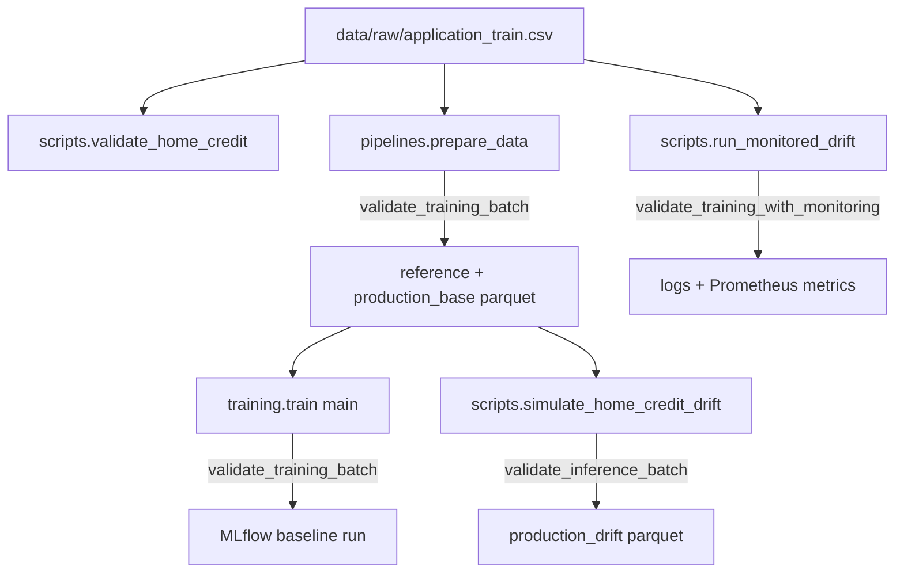

# Data Contracts & Validation (Pandera)

The project treats data quality as a hard gate. A Pandera schema in `src/data/contracts.py` defines what a valid Home Credit batch looks like. Every stage that ingests or retrains on raw data calls it first. A violation raises, so downstream artifacts are not produced from bad data. For where this sits in the overall system, see the [architecture overview](../architecture/overview.md). For the stages that consume it, see [ML pipeline and tracking](../workflows/ml_pipeline_and_tracking.md).

## Loading the raw data

`src/data/home_credit.py` owns access to the Kaggle `application_train.csv`:

- `raw_path()` resolves `settings.data_dir / "raw" / "application_train.csv"`.
- `load_application_train()` reads only the columns in `RAW_COLUMNS` (defined in `src/features/build.py`). It raises `FileNotFoundError` with the Kaggle download URL if the file is missing.
- `split_reference_production()` does a stratified split on `TARGET` with a fixed seed. It returns a reference set and a production base, each sorted by index.

`RAW_COLUMNS` is wider than the contract. It adds `CODE_GENDER` (bias analysis only) and the other categorical and numeric model inputs. The schema is `strict=False`, so those extra columns pass through unchecked.

## The Pandera contract

`credit_schema(training: bool = True)` builds a `pa.DataFrameSchema`. The training schema is named `HomeCreditTraining` and the inference schema `HomeCreditInference`. Both use `strict=False` and `coerce=False`: extra columns are allowed, and dtypes must already be correct rather than being silently cast.

| Column | Type | Rule |
| --- | --- | --- |
| `SK_ID_CURR` | int | not null, unique |
| `AMT_INCOME_TOTAL` | float | `> 0`, not null |
| `AMT_CREDIT` | float | `> 0`, not null |
| `AMT_ANNUITY` | float | `> 0`, **nullable** |
| `DAYS_BIRTH` | int | `<= -6575` (about 18 years), not null |
| `CNT_CHILDREN` | int | `>= 0`, not null |
| `NAME_INCOME_TYPE` | str | not null |
| `TARGET` (training only) | int | in `{0, 1}`, not null |

`FEATURE_COLUMNS` lists the seven non-target columns. The validation scripts use it to read only the contracted columns.

The two public entrypoints differ only in the schema variant:

- `validate_training_batch(df)` requires `TARGET`.
- `validate_inference_batch(df)` omits `TARGET`.

Both call `.validate(df, lazy=True)`. Lazy validation collects every violation and raises one `pandera.errors.SchemaErrors`. Its `failure_cases` frame has `column`, `check` and `failure_case` fields. Without `lazy`, Pandera would stop at the first `SchemaError`. On success the validated frame is returned.

## Where the contract is enforced

Where `validate_training_batch` and `validate_inference_batch` are called:

- **`scripts/validate_home_credit.py`** is the standalone `validate` DVC stage (`dvc.yaml`). It reads the contracted columns plus `TARGET` from the CSV, prints the record count and validates. It raises `FileNotFoundError` if the file is absent.
- **`src/pipelines/prepare_data.py`** validates the raw frame *before* splitting or writing. A violation raises `SchemaErrors` and nothing is written to `data/processed`. The persisted columns are raw because feature engineering lives inside the model pipeline.
- **`src/training/train.py`** re-validates `reference.parquet` at the start of `main()`, before MLflow starts a run. A tampered or stale reference file therefore cannot be trained on.
- **`scripts/simulate_home_credit_drift.py`** drops `TARGET` and validates the drifted production frame with the *inference* schema before writing `production_drift.parquet`. This confirms that simulated drift (scaled income and credit) stays within the valid domain.
- **`scripts/run_monitored_drift.py`** uses the monitored wrapper described below.

## Monitored validation wrapper

`validate_training_with_monitoring()` in `src/monitoring/validation.py` wraps `validate_training_batch`. It adds structured logs and Prometheus metrics and does not change the blocking behavior.

1. It uses the supplied logger, or `configure_json_logging()` if none is given.
2. It builds a context of `event="data_validation"`, `pipeline="home_credit"` and `records=len(batch)`.
3. It runs the validation inside `observe_pipeline("data_validation", metrics)`. That context manager (in `src/monitoring/metrics.py`) increments `credit_pipeline_runs_total{pipeline,status}` with `status` of `success` or `error` and observes `credit_pipeline_duration_seconds`.
4. The outcome decides the log line:
   - **Pass:** an INFO log, "Lote aprovado", with `status="approved"`.
   - **`SchemaError` or `SchemaErrors`:** a WARNING log, "Lote rejeitado pelo contrato Pandera", with `status="rejected"` and `error_type`. The exception is then re-raised.
   - **Any other exception:** an ERROR log, "Erro inesperado na validacao", with `status="error"`. It is re-raised.

A rejected batch is not swallowed. The caller sees the same `SchemaErrors`, and the metric records `status="error"`. The `rejected` and `error` log statuses therefore distinguish a contract violation from an unexpected failure, but the metric label does not. The `metrics` and `logger` arguments are injectable. Tests pass an isolated `CollectorRegistry` from `build_metrics()` so counters do not leak between tests. Pipeline metrics, the textfile export and dashboards are covered in the [observability stack](../operations/observability_stack.md).

In `scripts/run_monitored_drift.py`, loading runs under `observe_pipeline("data_loading")` and validation runs next. Drift monitoring follows, and the registry is written to `operational_metrics.prom` in a `finally` block. Metrics are therefore exported even when validation fails.

## Invalid-batch demo

`scripts/demo_invalid_batch.py` (`uv run python -m scripts.demo_invalid_batch`) shows the gate working:

1. It reads five real rows (`nrows=5`) with `FEATURE_COLUMNS` and `TARGET`, then validates them and prints "Lote original aprovado".
2. It copies the frame and injects one violation per row:
   - negative income in row 0
   - zero credit in row 1
   - `DAYS_BIRTH=-3000` in row 2
   - `TARGET=3` in row 3
   - a duplicated `SK_ID_CURR` in row 4
3. It validates again and prints the `column`, `check` and `failure_case` fields from `SchemaErrors.failure_cases`.
4. If the invalid frame passes, it raises `RuntimeError`, which means the contract has regressed.

This script uses the unmonitored `validate_training_batch` and catches `SchemaErrors` itself.

## Tests

- `tests/unit/test_contracts.py` builds a synthetic valid batch. It checks that valid data passes. It parametrizes rejection of negative income, zero credit, a too-young `DAYS_BIRTH`, negative `CNT_CHILDREN` and `TARGET=3`, and asserts that the offending column appears in `failure_cases`. It also covers duplicate IDs, a nullable `AMT_ANNUITY` (a NaN is accepted and preserved) and an inference batch with no `TARGET`.
- `tests/unit/test_validation_monitoring.py` uses the `hc_df` fixture from `tests/unit/conftest.py`. It asserts that a valid batch logs `approved` with `records == 10` and increments `credit_pipeline_runs_total{pipeline="data_validation",status="success"}`. A batch with `AMT_CREDIT=0` raises `SchemaErrors`, logs `rejected` with `error_type == "SchemaErrors"` and increments the `error` status.
- `tests/unit/test_drift.py` validates simulated drifted frames against the training contract. This keeps the drift simulator inside the valid domain.

See the [test suite and CI](../testing/test_suite_and_ci.md) page for how these run.

## Extending the contract

- Add a column rule in `credit_schema`. Add it to `FEATURE_COLUMNS` as well if the scripts should read it, and extend the parametrized cases in `test_contracts.py`.
- Because `strict=False`, new model inputs added to `RAW_COLUMNS` are not validated until they are added to the schema.
- Because `coerce=False`, a CSV or parquet whose dtype drifts (for example an integer column read as float because of NaNs) fails validation instead of being converted.
- Keep `lazy=True` so the failure report lists all violations at once.
