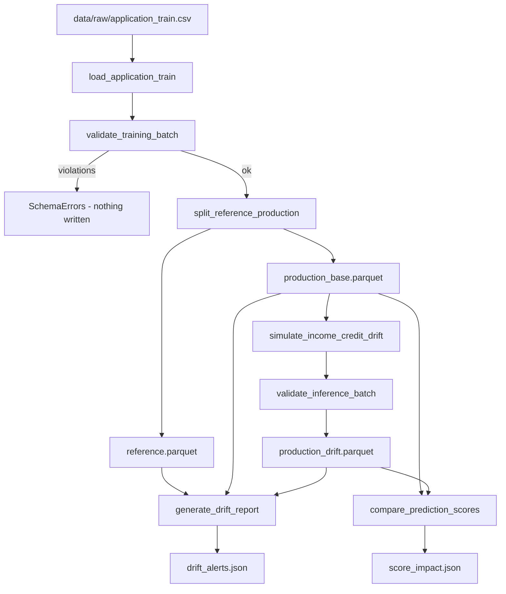

# Data Contracts, Drift Detection and Score Impact

This area covers the data-quality and data-shift side of the credit-risk project. It has four parts:

1. A **Pandera contract** that rejects bad Home Credit batches.
2. A **loader and splitter** that turns the raw Kaggle CSV into a reference set and a production set.
3. A **controlled drift simulation** and an **Evidently PSI monitor** that detects the simulated shift.
4. A **score-impact comparison** that shows how many model decisions change under drift.

Pipeline orchestration and model training are covered in [ML Pipeline and Tracking](../workflows/ml_pipeline_and_tracking.md). Prometheus metrics and alert rules are covered in [Observability Stack](../operations/observability_stack.md). The overall layout is in [Architecture Overview](../architecture/overview.md). The tests for this area are summarized in [Test Suite and CI](../testing/test_suite_and_ci.md).

## End-to-end flow



The diagram shows how data moves from the raw CSV through the contract gate, the split, drift simulation, PSI monitoring and score-impact analysis.

## Pandera contracts (`src/data/contracts.py`)

`credit_schema(training=True)` builds a `pandera.pandas.DataFrameSchema` over seven feature columns, listed in `FEATURE_COLUMNS`:

| Column | Rule |
| --- | --- |
| `SK_ID_CURR` | `int`, not null, **unique** |
| `AMT_INCOME_TOTAL` | `float`, `> 0`, not null |
| `AMT_CREDIT` | `float`, `> 0`, not null |
| `AMT_ANNUITY` | `float`, `> 0`, **nullable** |
| `DAYS_BIRTH` | `int`, `<= -6575` (at least about 18 years old), not null |
| `CNT_CHILDREN` | `int`, `>= 0`, not null |
| `NAME_INCOME_TYPE` | `str`, not null |

Training mode adds `TARGET` (`int`, in `{0, 1}`, not null). Inference mode (`training=False`) omits it.

Design choices that affect how you change or call the contract:

- **`strict=False`**: extra columns are allowed. The loader reads many more columns than the contract covers, and the contract only constrains the seven features plus `TARGET`.
- **`coerce=False`**: dtypes must already be correct. A float stored as an object column fails the contract. It is not silently converted.
- **`lazy=True`** in both `validate_training_batch` and `validate_inference_batch`: all violations are collected and raised together as `SchemaErrors`. Its `failure_cases` frame carries the `column`, `check` and `failure_case` columns.
- `AMT_ANNUITY` is nullable because the raw data has missing annuities. Downstream feature code handles the NaNs.

### Where the contract is enforced

- **Ingestion gate:** `src/pipelines/prepare_data.py` calls `validate_training_batch` on the raw frame *before* splitting or writing anything. A violation raises `SchemaErrors`, so the ingestion is blocked and no parquet is written.
- **Drifted data:** `scripts/simulate_home_credit_drift.py` drops `TARGET` and calls `validate_inference_batch` on the simulated data before saving it. Drift must change the distribution but not break the contract. Inference data has no label.
- **Monitored validation:** `validate_training_with_monitoring` in `src/monitoring/validation.py` wraps `validate_training_batch` in `observe_pipeline("data_validation", metrics)`. It logs structured JSON with `event=data_validation`, `pipeline=home_credit` and the record count. The status field is `approved` for a clean batch and `rejected` for a `SchemaError` or `SchemaErrors`, logged at warning level. Any other exception gets status `error` at error level. Every exception is re-raised, so monitoring never swallows a failure. The default metrics object is the module-level `METRICS`, and tests can inject their own.
- **Standalone scripts:** `scripts/validate_home_credit.py` validates the full CSV (the seven features plus `TARGET`). `scripts/demo_invalid_batch.py` reads five real rows and injects five violations: a negative income, a zero credit, an underage `DAYS_BIRTH`, `TARGET=3` and a duplicated ID. It prints the `failure_cases` table. It raises `RuntimeError` if the contract wrongly accepts the batch.

## Loading and splitting (`src/data/home_credit.py`)

- `raw_path()` resolves to `settings.data_dir / "raw" / "application_train.csv"`.
- `load_application_train()` reads only `RAW_COLUMNS` from `src/features/build.py`. These are the ID, `TARGET`, gender, `DAYS_BIRTH`, the categorical columns and the raw numeric columns. It raises `FileNotFoundError` with the Kaggle download URL when the file is missing.
- `split_reference_production(df, production_size, seed)` uses `train_test_split` **stratified on `TARGET`**. It returns both halves sorted by index.
- `prepare_data.run()` uses `production_size=0.3`, so about 70% of rows become `reference.parquet` and 30% become `production_base.parquet`, in `data/processed`. The seed is `settings.random_seed`.
- The persisted data is **raw columns only**. Feature engineering (`build_features`) lives inside the model pipeline. Simulated changes to income or credit therefore propagate into derived ratios such as `CREDIT_INCOME_RATIO` when the model scores them.

## Drift simulation (`src/data/simulate_drift.py`)

`simulate_income_credit_drift(data, fraction=0.60, income_multiplier=1.40, credit_multiplier=1.30, seed=42)` returns a deep copy of the data.

- It picks `max(1, int(len * fraction))` rows without replacement using `numpy.random.default_rng(seed)`.
- It multiplies `AMT_INCOME_TOTAL` and `AMT_CREDIT` on the **same selected positions**.
- **Validation:** it raises `ValueError` if either column is missing, if the frame is empty, if `fraction` is outside `(0, 1]`, or if either multiplier is `<= 1`. Drift is only ever upward.
- **Invariants:** the input frame is never mutated. The same seed gives identical output. IDs and `TARGET` are untouched, so the result still passes the training contract.

The default values are `0.60`, `1.40` and `1.30`. The script `scripts/simulate_home_credit_drift.py` uses stronger settings: `fraction=0.80`, `income_multiplier=1.80`, `credit_multiplier=1.70`, `seed=42`. It writes `data/processed/production_drift.parquet`. It refuses to run if `production_base.parquet` is missing and tells the user to run the preparation pipeline first. It also prints the mean before and after, and the percentage change, for both columns.

## Evidently drift monitor (`src/pipelines/drift_monitor.py`)

`generate_drift_report(reference, current, output)`:

1. Checks that both frames contain `DRIFT_COLUMNS` (`AMT_INCOME_TOTAL`, `AMT_CREDIT`) and are non-empty. Otherwise it raises `ValueError` naming "referência" or "produção".
2. Samples up to `SAMPLE_SIZE = 5000` rows from each frame with `RANDOM_SEED = 42`, so the report is deterministic.
3. Runs an Evidently `Report` with `DataDriftPreset(columns=DRIFT_COLUMNS, method="psi", threshold=PSI_THRESHOLD)`. The threshold is `0.2`.
4. Saves the HTML to `output` (creating parent directories). Writes the JSON snapshot next to it with the same stem and a `.json` suffix.

`extract_psi_alerts(report_path)` parses that JSON. It keeps only metrics whose `config.type` ends with `:ValueDrift`. For each column it returns `{psi, threshold, alert}`, where `alert = psi >= threshold`, so a PSI exactly equal to the threshold alerts. It raises `ValueError` if no PSI metric is found. That guards against Evidently format changes silently producing an empty "no alerts" result.

### `scripts/run_drift.py`

The script reads `reference.parquet`, `production_base.parquet` and `production_drift.parquet` from `data/processed`. It produces two scenarios:

- **baseline**: reference vs. untouched production, written to `reports/drift_baseline.html` and `.json`.
- **simulated**: reference vs. drifted production, written to `reports/drift_simulated.html` and `.json`.

It prints each column's PSI and a status line, then writes the combined result to `reports/drift_alerts.json`. The committed example shows the intended behavior:

| Scenario | Column | PSI | Alert |
| --- | --- | --- | --- |
| baseline | `AMT_INCOME_TOTAL` | about 0.002 | no |
| baseline | `AMT_CREDIT` | about 0.008 | no |
| simulated | `AMT_INCOME_TOTAL` | about 0.673 | yes |
| simulated | `AMT_CREDIT` | about 0.452 | yes |

The baseline sits near zero because the stratified split is random. The simulated scenario is well above 0.2.

### Link to Prometheus

`scripts/run_monitored_drift.py` chains the pieces. It loads the data under `observe_pipeline("data_loading")` and runs `validate_training_with_monitoring`. Then, under `observe_pipeline("drift_monitor")`, it calls `run_drift.main()`. It reads `drift_alerts.json` and calls `record_psi` for each feature in the **`simulated`** scenario only. That sets the `credit_data_drift_psi{feature=...}` gauge. A `finally` block always writes `reports/operational_metrics.prom`, even if validation or drift fails. See [Observability Stack](../operations/observability_stack.md) for the alert rules built on that gauge. There is no automated notification or scheduling; alert evaluation happens in the Prometheus rules.

## Score-impact analysis (`src/pipelines/score_impact.py`)

`compare_prediction_scores(production, drifted, model, threshold)` returns `(comparison_frame, summary_dict)`. It answers the question: for the same customers, how much does the model's output move once inputs drift?

Preconditions, each raising `ValueError`:

- `threshold` must be strictly between 0 and 1.
- Neither frame may be empty.
- Both frames must contain `SK_ID_CURR`, which must have no nulls and no duplicates.
- Both frames must contain exactly the same set of IDs.

Mechanics:

- `TARGET` is dropped if present before scoring. The test `FakeModel` asserts it never reaches the model.
- Each frame is scored with `src.models.baseline.score`, which returns probabilities.
- The two score frames are merged on ID with an inner join and `validate="one_to_one"`. Alignment is therefore **by ID, not row order**. The unit test deliberately reverses the order of the drifted frame.
- The comparison frame has `score_before`, `score_after`, `score_delta` and `crossed_threshold`. A customer counts as crossed when the "positive" status (`score >= threshold`) differs before and after, in either direction.

The summary contains `records`, `threshold`, `mean_score_before`, `mean_score_after`, `mean_absolute_change`, `share_above_threshold_before`, `share_above_threshold_after`, `changed_decisions` and `changed_decisions_pct`.

`scripts/analyze_score_impact.py` loads the processed production and drifted parquet files, plus `load_model()` and `load_threshold()` from `src/models/baseline.py`. It writes the summary to `reports/score_impact.json`. In the committed report, 92,254 records were compared at a threshold of about 0.141. About 4.81% (4,440) of decisions changed. The share above the threshold fell from about 15.3% to 13.9%, and the mean score fell from about 0.0806 to 0.0755 (mean absolute change about 0.0167). Drift in income and credit does not simply push scores up. The effect depends on how the model uses the derived ratios.

## Running the workflow

Run these steps in order (the order follows the README):

```bash
uv run python -m src.pipelines.prepare_data
uv run python -m scripts.simulate_home_credit_drift
uv run python -m scripts.run_drift
uv run python -m scripts.analyze_score_impact
uv run python -m scripts.run_monitored_drift   # validation + drift + Prometheus textfile
uv run python -m scripts.demo_invalid_batch    # contract-rejection demo
```

`analyze_score_impact` needs a trained model and threshold. See [ML Pipeline and Tracking](../workflows/ml_pipeline_and_tracking.md).

## Tests that matter

- `tests/unit/test_contracts.py` covers a valid batch, rejection of each bad value (negative income, zero credit, underage birth, negative children, `TARGET=3`), duplicated IDs, nullable annuity, and inference without `TARGET`.
- `tests/unit/test_drift.py` checks that a 60% simulation changes exactly 12 of 20 rows by the 1.40 and 1.30 multipliers. It also checks that IDs and `TARGET` stay equal, that the result still passes the training contract, that the same seed is reproducible without mutating the input, and that invalid fractions are rejected.
- `tests/unit/test_score_impact.py` covers ID alignment with reordered rows, mismatched IDs, duplicated IDs and an invalid threshold.
- `tests/unit/test_validation_monitoring.py` covers the logging and metrics wrapper.

## Extending safely

- **A new contract column:** add it to `credit_schema` and to `FEATURE_COLUMNS` if the scripts should read it. Remember `coerce=False`, so check the dtype that `pd.read_csv` produces.
- **A new drift column:** extend `DRIFT_COLUMNS`. Simulated drift must also change it, and the Prometheus consumer reads whatever columns appear in the `simulated` entries of `drift_alerts.json`.
- **A different PSI threshold:** change `PSI_THRESHOLD`. It is written into each alert entry, so downstream consumers see the value used.
