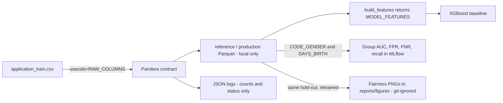

# Governance, LGPD & Model Limitations

This page covers the constraints that governance and privacy place on data and model handling in the Home Credit credit-scoring project. Most of the prose lives in the project `README.md` (sections "Governança, privacidade e evolução do projeto", "Governança e LGPD" with its Privacy By Design table, storage review and risk matrix, and the fairness sections "Análise inicial por grupos", "Métricas de erro por grupo" and "Gráficos de fairness"). The repository code enforces only part of it. The rest is a plan for how a fintech would run the pipeline on real customer data.

Related pages: [Architecture Overview](../architecture/overview.md), [ML pipeline and tracking](../workflows/ml_pipeline_and_tracking.md), [Drift monitoring and score impact](../workflows/drift_monitoring_and_score_impact.md), [Data contracts](data_contracts.md).

## Scope and framing

- The scenario is a fintech using a model to support credit decisions. The academic dataset is the public Kaggle Home Credit Default Risk file, in which `SK_ID_CURR` has no link to identifiable people. The LGPD plan describes how the pipeline would treat real data (`README.md`).
- `docs/model_card.md` is only an outline. It lists nine headings (model details, intended use, factors, metrics, evaluation data, training data, quantitative analysis including fairness, ethical considerations, limitations) and has no content. The effective model-card material is in the README: baseline metrics, group AUCs and limitation lists.
- `docs/adr/0001-template.md` is an ADR template (status, context, decision, consequences). `docs/adr/` has no real decisions yet. `docs/architecture.md` holds one flowchart: `data/raw` → `src/data` → `src/features` → `src/training` → MLflow → `src/api`.

## Controls the code enforces

| Control | Where it is enforced |
|---|---|
| Data minimization | `RAW_COLUMNS` in `src/features/build.py` is a closed list. `src/data/home_credit.py` reads the CSV with `usecols=RAW_COLUMNS`, so only those columns of the 122 in `application_train.csv` are loaded. |
| Protected attribute kept out of the model | `CODE_GENDER` (`GENDER`) is in `RAW_COLUMNS` but not in `MODEL_FEATURES`. `build_features` returns exactly `MODEL_FEATURES`, so gender never reaches the XGBoost pipeline. It is read only for the fairness audit. |
| Identifier not a feature | `SK_ID_CURR` is in `RAW_COLUMNS` for uniqueness and joins (for example aligning scores before and after drift). It is not in `MODEL_FEATURES`. The README says it is not logged or exported as a metric. |
| Log hygiene | `JsonFormatter` in `src/monitoring/logging_config.py` emits only `timestamp`, `level`, `message` and the whitelisted extras `event`, `status`, `records`, `pipeline` and `error_type`. Validation logs carry the batch size and status, never income, identifiers or sample rows. The `credit_scoring` logger has `propagate = False`. |
| Local-only artifacts | `.gitignore` excludes `data/raw|interim|processed|features/*`, `models/*`, `mlruns/`, `mlartifacts/`, `mlflow.db`, `.env`, `reports/figures/*.png` (generated fairness figures, regenerable with `scripts/generate_fairness_plots.py`), `/reports/*.html` and `/reports/*.prom`. `.gitkeep`, `data/**/*.dvc`, `data/**/.gitignore`, `models/.gitignore` and `models/baseline_metrics.json` (kept in Git for `dvc metrics diff`) are explicit exceptions. |
| Local-only observability | In `compose.observability.yaml`, ports 9100, 9090 and 3000 bind to `127.0.0.1`. `reports/` is mounted read-only into Node Exporter. Grafana requires `GRAFANA_ADMIN_PASSWORD` at startup and disables sign-up. |

Note the gap in the identifier control. `SK_ID_CURR` is persisted in the local Parquet files (`reference`, `production_base`), because it is part of `RAW_COLUMNS`. The README describes pseudonymization with a keyed hash as a production plan. The code does not implement it.

The diagram shows where data is minimized, where gender is diverted to audit only, what reaches logs, and that the fairness figures stay local.

The README's storage review table also lists where each artifact lives. Raw CSV, `reference.parquet`, `production_base.parquet`, `production_drift.parquet`, `baseline.joblib` and `baseline_metrics.json` are tracked by DVC rather than Git. The Evidently HTML reports are kept out of Git, while the JSON alert and score-impact summaries are aggregate-only and may be versioned. One README table row says `baseline_metrics.json` is outside Git, which disagrees with the `.gitignore` exception above. The `.gitignore` rule is what Git applies.

## Personal data inventory (README)

| Data | Classification | Handling |
|---|---|---|
| `SK_ID_CURR` | Identifier | Not a feature. A production deployment would pseudonymize it. |
| `CODE_GENDER` | Protected attribute (discrimination risk) | Excluded from features, used for bias audit only. |
| `DAYS_BIRTH` → `AGE_YEARS` | Protected attribute / quasi-identifier | **Kept as a model feature** for credit-risk relevance. Monitored by age band. |
| Income, credit, annuity, employment | Personal financial data | Model features. Only the `RAW_COLUMNS` columns are loaded. |
| `EXT_SOURCE_1/2/3` | External bureau scores | Model features. Third-party origin, so production would need a data-sharing contract. |

The README states that gender and age are not sensitive data under LGPD art. 5, II, but that the non-discrimination principle (art. 6, IX) still requires monitoring their effect on decisions.

## Purpose, legal basis and data-subject rights (planned)

- Legal bases cited: art. 7, X (credit protection) as the main basis, and art. 7, V (contract execution or preliminary procedures) because analysis happens at the customer's request. Data is used only for credit-risk assessment. Other uses, such as marketing, would need a new legal basis.
- Principles cited: minimization (closed column list), purpose (gender only for audit), security (data and artifacts kept out of GitHub) and transparency (README and model card).
- Art. 18 rights (access, correction, deletion) would go through the DPO channel. Under art. 20 (automated decisions), customers can ask for review and for the criteria used. **The current model produces no individual explanations.** The plan for production is to return top factors per decision and send refusals to human review.
- Roles: the fintech is the controller. Infrastructure providers and credit bureaus are operators. The DPO (art. 41) is the channel for data subjects and the ANPD. The record of operations (art. 37) and the impact report RIPD (art. 38) are to be reviewed at every model retrain. Incidents with relevant risk are reported to the ANPD and to the data subjects.

The README's "Próximos trabalhos recomendados" list still includes recording minimization, purpose, legal-basis, access-control and retention policies, and investigating error rates by group on production data. Treat the LGPD section as intent and documentation, not as an audited compliance state. Its own opening paragraph says the exploratory group metrics do not prove fairness, absence of bias or LGPD compliance.

The README also maps the seven Privacy By Design / By Default principles (LGPD art. 46, Cavoukian) onto concrete controls: Pandera contracts reject bad batches before ingestion, only `RAW_COLUMNS` are loaded, `CODE_GENDER` is excluded in code rather than by a flag, logs carry no individual data, and DVC stores only hashes of local data. A risk matrix (R1–R14) rates privacy, bias, operation and compliance risks. Residual risk stays medium for indirect discrimination via proxies (R4/R5), drift and data freshness (R6/R7), and transparency and representativeness (R12/R13). The README also documents a causal DAG that explains why dropping gender does not close the proxy paths via income, occupation and `EXT_SOURCE_*`.

## Retention plan (art. 16)

| Data | Period | Basis |
|---|---|---|
| Project raw and processed data | Deleted at project end | The academic purpose ends. |
| Production, negative information | Up to 5 years | CDC art. 43, §1 |
| Production, repayment history | Up to 15 years | Lei 12.414/2011 (Cadastro Positivo) |
| Prometheus metrics | 7 days | `--storage.tsdb.retention.time=7d` in `compose.observability.yaml`. This is the one retention value enforced in configuration. |
| Structured logs | Short term, aggregates only | They contain no personal data. |

Changing the Prometheus retention flag changes a documented LGPD retention commitment, so update the README table with it. `docker compose down -v` deletes the Prometheus and Grafana volumes and should be run only deliberately.

## Bias mitigation and fairness evidence

- Gender is excluded from features and used only for per-group measurement. Age remains a feature.
What the code computes (`src/training/train.py`):

- `fairness_metrics` evaluates the validation hold-out (stratified 20% of the reference data) by gender (`F`/`M` only, so `XNA` is dropped) and by age band (`lt30`, `30_44`, `45_59`, `60_plus`, derived from `DAYS_BIRTH`).
- `auc_by_group` gives `auc_<gender|age>_<group>`. It skips groups with fewer than `MIN_GROUP_POSITIVES = 30` positives or without both classes.
- `error_rates_by_group` adds `fpr_`, `fnr_` and `recall_` metrics per group (`<metric>_<gender|age>_<group>`), using `error_rates` (confusion matrix with `labels=[0, 1]`, 0.0 on empty denominators) at the **same F1-optimal threshold** as the overall metrics. It has no minimum-positives guard, so small groups still get rates.
- `main()` logs the overall and group metrics to MLflow in one `log_metrics` call (see [ML pipeline and tracking](../workflows/ml_pipeline_and_tracking.md)). Group metrics are not written to `models/baseline_metrics.json`.

What the README reports:

- Group AUCs: female 0.7671, male 0.7515, under 30 0.7505, 30–44 0.7653, 45–59 0.7627, 60+ 0.7290. The 60+ band shows the largest gap. The README does not tabulate the group FPR/FNR/recall values. It explains how to read them: a high FPR means good payers in that group are refused more often, and a high FNR or low recall means real defaulters slip through. It calls rate gaps more directly actionable than AUC gaps.
- AUC per group does not establish fairness. Differences alone do not prove discrimination, and income or occupation may act as proxies for protected attributes. The README still lists sample sizes, representativeness, correlated variables and error rates on production data as open work. The risk matrix keeps R4/R5 at medium residual risk.

### Fairness plots

`scripts/generate_fairness_plots.py` (README section "Gráficos de fairness") produces four PNGs in `reports/figures/`:

| File | Content |
|---|---|
| `roc_by_gender.png` | ROC curves for `F` and `M` against the overall dashed curve, with AUC in the legend |
| `roc_by_age.png` | The same by age band |
| `error_rates_by_gender.png` | Grouped bars of FPR, FNR and recall per gender, with value labels |
| `error_rates_by_age.png` | The same by age band |

Run it with `uv run python -m scripts.generate_fairness_plots`, or as the `fairness_plots` stage in `dvc.yaml`.

- The script raises `FileNotFoundError` unless `data/processed/reference.parquet` exists. It then calls `train()` again and recomputes the same stratified split to get `x_val`, `y_val` and the scores. It does not load `models/baseline.joblib` and does not log to MLflow. It prints the overall metrics and group metrics to stdout.
- The plotting functions in `src/visualization/fairness_plots.py` reuse `AGE_BINS`, `AGE_LABELS` and `error_rates` from `train.py`, so the plots and the MLflow metrics share the same grouping and threshold. The module selects matplotlib's headless `Agg` backend.
- The plots have no `MIN_GROUP_POSITIVES` guard. The ROC plot only skips groups that have a single class, and the error-rate bars include every non-null group.
- The PNGs are regenerable artifacts and are **not committed**. `.gitignore` excludes `reports/figures/*.png`, and the DVC stage declares them with `cache: false`. They contain only aggregate rates and curves, never records. No test in `tests/` imports the plotting module. The group metrics themselves are covered by `tests/unit/test_baseline.py`, which checks the `auc_gender_`, `fpr_gender_`, `fnr_age_` and `recall_gender_` keys and that `auc_gender_XNA` is absent.

## Known model and process limitations

Model and evaluation:
- Baseline (README): ROC-AUC 0.7657, KS 0.4007, PR-AUC 0.2410, F1 0.3092 at threshold 0.1432. The threshold maximizes F1 on the same validation set used to report it, which makes F1 optimistic. Independent data is recommended.
- The Pandera contract covers 8 of the 122 columns. Other model inputs are not covered by it.
- `validate_training_batch` is called in `prepare_data`, `train` and the monitored validation. `validate_inference_batch` exists, but `score()` in `src/models/baseline.py` does **not** call it. Inference validation must be added when an operational interface is built.
- Unknown categories at inference become `NaN` in the encoder, so new categories do not break scoring. They are also not flagged.
- Production data is a random split of the same history (215,257 reference rows, 92,254 production rows). It is not a later period.

Drift and monitoring (see [Drift monitoring and score impact](../workflows/drift_monitoring_and_score_impact.md)):
- The drift is a synthetic stress scenario (income ×1.8 and credit ×1.7 on 80% of rows, seed 42). Only two columns are monitored, on 5,000-row samples. The PSI threshold of 0.20 is demonstrative.
- Score impact (4.64% of classifications changed) shows behavior change. It does not prove performance degradation or causality.
- Metrics are per-run snapshots, so `.prom` values can go stale and an alert can stay `FIRING` indefinitely. There is no Alertmanager or notification routing, no scheduling, and no API or latency metrics. The stack is for local demonstration and would need authentication, TLS, credential management and access segregation before public exposure.
- Data versioning: DVC tracks `application_train.csv` by hash, but no remote is configured, so each person downloads the CSV from Kaggle.

## Rules of thumb when changing data or model handling

- Adding a column to `RAW_COLUMNS` widens the personal data loaded. Update the inventory table and check that the column is not protected or a proxy. Adding it to the features also changes `MODEL_FEATURES`.
- Never add `CODE_GENDER` to `MODEL_FEATURES`. Keep any new protected-attribute audit outside the feature list.
- Do not add values from records (identifiers, income, row samples) to log `extra` fields. The formatter whitelist is the guardrail, so extend it carefully.
- Keep raw data, processed data, model binaries and generated reports out of git. Decide explicitly before committing any new artifact type. Fairness figures are regenerable, so regenerate them rather than committing them.
- If you change the split, `AGE_BINS`, `AGE_LABELS` or the threshold logic in `train.py`, re-run the plots. The script repeats the 20% split literal, so keep it in sync.
- Record changes to retention, fairness metrics or limitations in the README governance sections. Fill `docs/model_card.md` and `docs/adr/` when decisions need a formal record.
