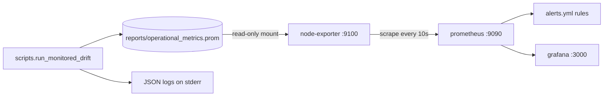

# Observability Stack: Logging, Metrics, Prometheus and Grafana

The project is a **batch** system, not a long-running service. Observability therefore works through files: a Python script runs validation and drift detection, writes a Prometheus *textfile* (`reports/operational_metrics.prom`), and a local docker compose stack reads that file, evaluates alert rules and renders a dashboard. There is no application HTTP exporter. See [Architecture Overview](../architecture/overview.md) for the larger picture and [Data Contracts and Drift](../concepts/data_contracts_and_drift.md) for what is validated and how PSI is computed.



Caption: data path from the monitored run to Prometheus alerts and the Grafana dashboard.

## Structured logging (`src/monitoring/logging_config.py`)

- `JsonFormatter` renders each record as one JSON object with `timestamp` (UTC ISO-8601), `level` and `message`. It copies only an allow-list of optional `extra` fields when present on the record: `event`, `status`, `records`, `pipeline`, `error_type`. Any other `extra` key is silently dropped, so a new field must be added to that tuple to appear in logs.
- `configure_json_logging()` returns the logger named `credit_scoring` at `INFO` with `propagate = False`, attaching a single `StreamHandler` with the JSON formatter only if the logger has no handlers yet. Repeated calls are idempotent and do not duplicate output.
- The only producer today is `validate_training_with_monitoring` in `src/monitoring/validation.py`. It logs with `event="data_validation"`, `pipeline="home_credit"` and the row count, and never the data itself:
  - `INFO` "Lote aprovado" with `status="approved"`;
  - `WARNING` with `status="rejected"` and `error_type` when Pandera raises `SchemaError` or `SchemaErrors`;
  - `ERROR` with `status="error"` for any other exception.
  In every failure case the exception is re-raised.

## Prometheus metrics (`src/monitoring/metrics.py`)

`build_metrics(registry)` creates a frozen `MonitoringMetrics` bundle. Passing a private `CollectorRegistry` isolates it (tests and the monitored script do this); the module-level `METRICS` uses the default global registry.

| Metric | Type | Labels | Meaning |
|---|---|---|---|
| `credit_pipeline_runs_total` | Counter | `pipeline`, `status` | Runs per stage; `status` is `success` or `error` |
| `credit_pipeline_duration_seconds` | Histogram | `pipeline` | Stage duration |
| `credit_data_drift_psi` | Gauge | `feature` | Latest PSI per monitored column |

- `observe_pipeline(pipeline, metrics)` is a context manager. It times the block with `perf_counter`, sets `status="error"` on any exception and re-raises it, and in a `finally` increments the counter and observes the duration. Success and failure are both always recorded.
- `record_psi(feature, value, metrics)` raises `ValueError` if the value is non-finite or negative, so bad PSI values never reach the gauge.

## The monitored run (`scripts/run_monitored_drift.py`)

```bash
uv run python -m scripts.run_monitored_drift
```

Prerequisites (from the project README): the raw dataset, processed Parquet files (including the drift scenario) must already exist, e.g. via `uv run python -m src.pipelines.prepare_data`.

Control flow in `main()`:

1. Create a fresh `CollectorRegistry` and metrics bundle.
2. `observe_pipeline("data_loading")` around `load_application_train()`.
3. `validate_training_with_monitoring(data, metrics=metrics)`, recorded as pipeline `data_validation` and logged as above. An invalid batch raises here, so **drift never runs on invalid data**.
4. `observe_pipeline("drift_monitor")` around `scripts.run_drift.main()`, which writes the Evidently reports and `reports/drift_alerts.json`. The script then reads that JSON and calls `record_psi` for every feature of the **`simulated`** scenario only; the baseline scenario's PSI is not exported.
5. A `finally` block always creates `reports/` if needed and writes the registry with `write_to_textfile` to `reports/operational_metrics.prom`, even when a step failed. The error then propagates.

The drift threshold (`PSI_THRESHOLD = 0.2` in `src/pipelines/drift_monitor.py`) is duplicated in the alert rule and in the dashboard colouring; they are not linked in code.

`tests/unit/test_run_monitored_drift.py` pins this behaviour using a temporary `REPORT_DIR` and monkeypatched loader and drift runner: success exports all three stages and the PSI; a drift failure still writes the file with `drift_monitor` `status="error"`; an invalid batch (`AMT_CREDIT = 0`) raises `SchemaErrors`, records `data_validation` as `error` and produces no `drift_monitor` series. `tests/unit/test_monitoring_metrics.py` covers success/error recording and PSI rejection; `tests/unit/test_logging_config.py` checks the JSON fields.

## Docker compose stack (`compose.observability.yaml`)

Project name `tech-challenge-fase4-observability`. All ports bind to `127.0.0.1`, and every service uses `restart: unless-stopped`.

| Service | Image | Port | Role |
|---|---|---|---|
| `node-exporter` | `prom/node-exporter:v1.12.1` | 9100 | Default collectors disabled; only the textfile collector, reading `./reports` mounted read-only at `/textfile` |
| `prometheus` | `prom/prometheus:v3.16.0` | 9090 | Loads `prometheus.yml` and `alerts.yml` read-only; TSDB in the `prometheus_data` volume, 7-day retention |
| `grafana` | `grafana/grafana:13.3.0` | 3000 | Provisioned datasource and dashboards; state in `grafana_data` volume |

Grafana requires `GRAFANA_ADMIN_PASSWORD` in the environment: the compose file uses `${GRAFANA_ADMIN_PASSWORD:?...}`, so `up` and `config` fail if it is unset. The admin user is `admin` and sign-up is disabled. Do not commit the password. Because the password is stored in the `grafana_data` volume on first start, changing the variable later does not change an existing password (use `grafana cli admin reset-admin-password` in the container).

### Prometheus configuration

`infra/observability/prometheus/prometheus.yml` sets scrape and evaluation intervals to 10 s, loads `/etc/prometheus/alerts.yml`, and defines a single job `credit_scoring` with static target `node-exporter:9100`. Metric names from the `.prom` file therefore appear unchanged, with `job` and `instance` labels added.

### Alert rules (`infra/observability/prometheus/alerts.yml`)

| Alert | Expression | For | Severity |
|---|---|---|---|
| `CreditScoringDataDrift` | `credit_data_drift_psi >= 0.20` | 30 s | warning; one instance per `feature` |
| `CreditScoringExporterDown` | `up{job="credit_scoring"} == 0` | 1 m | critical |

There is no Alertmanager, so a firing alert is visible only at `http://localhost:9090/alerts`; nothing is sent to email or Teams.

### Grafana provisioning

- `grafana/datasources/prometheus.yml`: default, non-editable datasource `Prometheus` with `uid: prometheus` pointing at `http://prometheus:9090`. Dashboard panels reference this UID, so do not change it without updating the JSON.
- `grafana/dashboard-provider.yml`: a file provider that loads `/var/lib/grafana/dashboards` (mounted read-only from `infra/observability/grafana/dashboards`), re-scanning every 30 s, with `allowUiUpdates: false`.
- `dashboards/credit-scoring-observability.json` (title "Credit Scoring | Observabilidade Operacional", uid `ad8lqdz`, default range 6 h) has three instant-query panels:
  1. "Data Drift por variável (PSI)": bar gauge of `credit_data_drift_psi`, red from 20% of the 0–1 range, i.e. PSI 0.2.
  2. "Tempo de execução dos pipelines": bar gauge of `credit_pipeline_duration_seconds_sum`, red above 80 s.
  3. "Status dos pipelines": table of `credit_pipeline_runs_total` with success/error colour mapping.

## Running the stack

```bash
uv run python -m scripts.run_monitored_drift          # produce reports/operational_metrics.prom
export GRAFANA_ADMIN_PASSWORD=...                     # never commit it
docker compose -f compose.observability.yaml config --quiet
docker compose -f compose.observability.yaml up -d
```

Checks: `curl -s http://localhost:9100/metrics | grep '^credit_'`, the `credit_scoring` target `UP` at `http://localhost:9090/targets`, and the dashboard at `http://localhost:3000`. Validate rule syntax with `docker compose -f compose.observability.yaml exec -T prometheus promtool check rules /etc/prometheus/alerts.yml` (prefix with `MSYS_NO_PATHCONV=1` in Windows Git Bash). Stop with `down`; avoid `down -v` unless you intend to delete Prometheus and Grafana data.

If the target is `UP` but no `credit_` series exist, the `.prom` file is missing: re-run the script.

## Changing things safely

- **New metric:** add it to `MonitoringMetrics` and `build_metrics`, emit it through a passed-in `metrics` bundle (not the global `METRICS`) in the script so it lands in the textfile registry, and add a test with an isolated `CollectorRegistry`.
- **New log field:** extend the tuple in `JsonFormatter.format` and the formatter test.
- **Alert threshold:** change `alerts.yml`, the dashboard threshold steps and, if intended to match, `PSI_THRESHOLD` together.
- **Dashboard edits:** make durable changes in the JSON file, since UI edits are not persisted (`allowUiUpdates: false`).
- **Port conflicts:** change only the host side of the port mapping; keep the in-network addresses `prometheus:9090` and `node-exporter:9100`.

## Known limitations

- Counters and histograms are rebuilt on every run and the `.prom` file is overwritten, so `credit_pipeline_runs_total` describes the latest run, not a cumulative total; `rate()` and `increase()` on it are not meaningful.
- Node Exporter keeps serving the last file, so a drift alert can stay firing indefinitely and stale data is not detected. There is no last-run timestamp metric or freshness rule.
- PSI is exported for the simulated scenario only, and the data is artificially drifted; no inference API metrics exist.
- The setup targets local demonstration, not public deployment (no TLS, access segregation or retention policy beyond 7 days).
