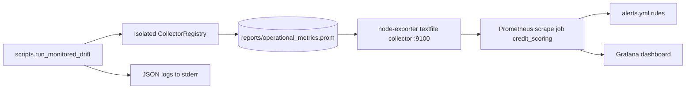

# Observability: Metrics, Logs, Prometheus, Grafana & Alerts

The project is a batch pipeline, not a long-running service. It therefore does not expose a `/metrics` HTTP endpoint. Instead, a Python run writes a Prometheus **textfile** (`reports/operational_metrics.prom`). A local Docker Compose stack then reads that file through Node Exporter's textfile collector, and Prometheus scrapes it and evaluates alert rules. Grafana shows a provisioned dashboard. Structured JSON logs are emitted separately, to the process stderr.

For where this fits in the system see the [Architecture Overview](../architecture/overview.md). For the validation step that is instrumented see [Data Contracts](../concepts/data_contracts.md). For where the PSI values come from see [Drift Monitoring and Score Impact](../workflows/drift_monitoring_and_score_impact.md). Environment handling is covered in [Configuration and Environment](../concepts/configuration_and_environment.md).

## End-to-end flow



Caption: a monitored run produces a `.prom` file that Node Exporter republishes; Prometheus scrapes it, evaluates alerts, and Grafana queries Prometheus.

## Application instrumentation

### Metrics (`src/monitoring/metrics.py`)

`build_metrics(registry=None)` returns a frozen `MonitoringMetrics` dataclass holding three instruments. Passing a `CollectorRegistry` isolates them (used by tests and by the export script). With no argument they register on the global `prometheus_client` `REGISTRY`.

| Metric | Type | Labels | Meaning |
|---|---|---|---|
| `credit_pipeline_runs_total` | Counter | `pipeline`, `status` | Runs per pipeline stage and outcome (`success` or `error`) |
| `credit_pipeline_duration_seconds` | Histogram | `pipeline` | Duration of each run, in seconds |
| `credit_data_drift_psi` | Gauge | `feature` | Latest PSI per monitored feature |

A module-level `METRICS = build_metrics()` is the default for callers that do not pass their own instance. Nothing in `src/` starts an HTTP exporter, so the global registry is never exposed. Only the registry written by `run_monitored_drift` reaches Prometheus.

- **`observe_pipeline(pipeline, metrics=METRICS)`** is a context manager. It times the block with `perf_counter`. It starts with status `success` and switches to `error` if any `Exception` escapes, and the exception is re-raised so the original failure is never hidden. In a `finally` block it increments `runs` and observes the elapsed time, so both are recorded on success and failure alike.
- **`record_psi(feature, value, metrics=METRICS)`** sets the gauge. It raises `ValueError` if the value is not finite or is negative, so an invalid PSI never reaches the exported file.

Pipeline label values in use are `data_loading`, `data_validation` and `drift_monitor`. The first and last are set by `run_monitored_drift`, and `data_validation` is set inside `validate_training_with_monitoring`.

### Structured logging (`src/monitoring/logging_config.py`)

`JsonFormatter` renders each record as one JSON object with `timestamp` (UTC, ISO 8601), `level` and `message`. It adds `event`, `status`, `records`, `pipeline` and `error_type` only when they are present on the record, which is how `extra={...}` fields reach the output. Other extras are silently dropped, so a new field must be added to the allow-list in `format`. Output uses `ensure_ascii=False`.

`configure_json_logging(logger_name="credit_scoring")` sets the logger to `INFO`, disables propagation and attaches a `StreamHandler` with `JsonFormatter` only if the logger has no handlers. Repeated calls therefore do not duplicate output. It does not read `settings.log_level`.

`validate_training_with_monitoring` in `src/monitoring/validation.py` is the only production caller. It uses an injected logger or else `configure_json_logging()`, and wraps validation in `observe_pipeline("data_validation")`. It logs with `event="data_validation"`, `pipeline="home_credit"` and `records=len(batch)`, plus one of these outcomes:

| Outcome | Level | `status` | Extra |
|---|---|---|---|
| Pandera `SchemaError` or `SchemaErrors` | WARNING | `rejected` | `error_type` |
| Any other exception | ERROR | `error` | `error_type` |
| Valid batch | INFO | `approved` | none |

Both failure branches re-raise, so a rejected batch still counts as `status="error"` in the metric. Logs carry only counts and error class names, not row contents. This is the privacy posture described in [Governance and LGPD](../concepts/governance_and_lgpd.md).

### Textfile export (`scripts/run_monitored_drift.py`)

`main()` builds an isolated registry and `MonitoringMetrics`, then runs these stages:

1. Load `application_train` under `observe_pipeline("data_loading")`.
2. Run `validate_training_with_monitoring` (the `data_validation` pipeline).
3. Under `observe_pipeline("drift_monitor")`, call the drift run, read `reports/drift_alerts.json`, and `record_psi` for every feature in its `simulated` section.
4. In a `finally` block, create the report directory and call `write_to_textfile` to write `reports/operational_metrics.prom`.

Because the write is in `finally`, the file is produced even when a stage fails, and the failing stage shows `status="error"`. A validation failure raises before the drift stage, so no `drift_monitor` series is exported in that case. Tests assert exactly this behaviour (`tests/unit/test_run_monitored_drift.py`). The PSI exported is the **simulated** scenario only.

This script is not a DVC stage. Run it by hand:

```bash
uv run python -m scripts.run_monitored_drift
```

## Compose stack (`compose.observability.yaml`)

The Compose project is `tech-challenge-fase4-observability`. All published ports bind to `127.0.0.1`.

| Service | Image | Port | Role |
|---|---|---|---|
| `node-exporter` | `prom/node-exporter:v1.12.1` | 9100 | Runs with `--collector.disable-defaults` and only the textfile collector. It mounts `./reports` read-only at `/textfile`. |
| `prometheus` | `prom/prometheus:v3.16.0` | 9090 | Mounts `prometheus.yml` and `alerts.yml` read-only and keeps data in the `prometheus_data` volume with 7-day retention. Depends on `node-exporter`. |
| `grafana` | `grafana/grafana:13.3.0` | 3000 | Provisioned from `infra/observability/grafana/`. Data is kept in the `grafana_data` volume. Depends on `prometheus`. |

Grafana uses user `admin`. `GRAFANA_ADMIN_PASSWORD` is required, because Compose substitutes `${GRAFANA_ADMIN_PASSWORD:?...}` and refuses to start if it is unset. Sign-up is disabled. The password is only applied when the Grafana volume is first initialised.

```bash
export GRAFANA_ADMIN_PASSWORD=...   # set interactively, never commit it
docker compose -f compose.observability.yaml config --quiet
docker compose -f compose.observability.yaml up -d
docker compose -f compose.observability.yaml ps
```

### Prometheus (`infra/observability/prometheus/`)

- `prometheus.yml`: scrape and evaluation interval are both `10s`. There is one scrape job, `credit_scoring`, targeting `node-exporter:9100`. It loads `/etc/prometheus/alerts.yml`. It has no `alerting:` section, so there is no Alertmanager.
- `alerts.yml`: one group, `credit-scoring-alerts`.

| Alert | Expression | `for` | Severity | Notes |
|---|---|---|---|---|
| `CreditScoringDataDrift` | `credit_data_drift_psi >= 0.20` | 30s | warning | One alert instance per `feature` label. The annotation notes that the PSI comes from the simulated scenario. |
| `CreditScoringExporterDown` | `up{job="credit_scoring"} == 0` | 1m | critical | Fires when Prometheus cannot scrape Node Exporter. |

The 0.20 threshold is repeated in the first Grafana panel, so a change to the alert limit should be mirrored in the dashboard. A FIRING alert only appears at `http://localhost:9090/alerts`. Nothing sends e-mail or chat notifications.

### Grafana provisioning (`infra/observability/grafana/`)

- `datasources/prometheus.yml` defines the default, non-editable datasource `Prometheus` with `uid: prometheus`, using proxy access to `http://prometheus:9090`. The dashboard panels reference this UID, so renaming it breaks them.
- `dashboard-provider.yml` is a file provider that reads `/var/lib/grafana/dashboards` every 30 seconds. It has `allowUiUpdates: false` and `disableDeletion: false`.
- `dashboards/credit-scoring-observability.json` is the dashboard `Credit Scoring | Observabilidade Operacional` (`uid` `ad8lqdz`, default range `now-6h`). Its three panels all use **instant** queries:

| Panel | Type | Query | Notes |
|---|---|---|---|
| Data Drift por variável (PSI) | bar gauge | `credit_data_drift_psi` | Scale 0 to 1, red from 20% (PSI 0.20), named by `feature` |
| Tempo de execução dos pipelines | bar gauge | `credit_pipeline_duration_seconds_sum` | Seconds, red from 80, named by `pipeline` |
| Status dos pipelines | table | `credit_pipeline_runs_total` | `success` is shown green and `error` red, and `Time`, `job` and `instance` columns are hidden |

Because dashboards are file-provisioned and UI saves are disallowed, durable changes must be made in the JSON file in the repository.

## Semantics and limitations to keep in mind

- **Snapshot, not history.** Each run starts with fresh counters and histograms and overwrites the `.prom` file. `credit_pipeline_runs_total` therefore describes the latest run only. Do not use `rate()` or `increase()` on it as a count of jobs.
- **Stale data persists.** Node Exporter keeps serving the last `.prom` file when no new run occurs. A drift alert can stay FIRING indefinitely, and `up` stays 1. There is no last-run-timestamp metric or freshness rule.
- **Batch only.** There is no inference-API, latency, or traffic instrumentation.
- **Local demo security.** The stack suits a developer laptop. Exposing it would need authentication, TLS and credential management.

## Troubleshooting

| Symptom | Check |
|---|---|
| `docker compose` refuses to start | Export `GRAFANA_ADMIN_PASSWORD` in the same shell. |
| Target `credit_scoring` is `UP` but no `credit_` series | Confirm `reports/operational_metrics.prom` exists, then rerun `uv run python -m scripts.run_monitored_drift`. Check with `curl -s http://localhost:9100/metrics \| grep '^credit_'` and `grep node_textfile`. |
| Target `DOWN` / `CreditScoringExporterDown` fires | Run `docker compose -f compose.observability.yaml ps` and `logs --tail=50`. |
| Grafana panels are empty | Check that the datasource UID is `prometheus` and that the Prometheus target is up. Panels use instant queries, so they need at least one scrape of a `.prom` file. |
| Forgotten Grafana password | The env var does not change a stored password. Use `grafana cli admin reset-admin-password` in the container. |
| Port already in use (3000, 9090, 9100) | Change only the host side of the mapping. Keep `prometheus:9090` and `node-exporter:9100` unchanged for container-to-container traffic. |
| Validate alert syntax | `docker compose -f compose.observability.yaml exec -T prometheus promtool check rules /etc/prometheus/alerts.yml` (prefix `MSYS_NO_PATHCONV=1` in Git Bash on Windows). |

Stop the stack with `docker compose -f compose.observability.yaml down`. Do not add `-v` unless you intend to delete the Prometheus and Grafana volumes.

## Tests

- `tests/unit/test_monitoring_metrics.py` uses isolated registries to check success and error counting, that the original exception is preserved, PSI storage per feature, and rejection of negative PSI.
- `tests/unit/test_logging_config.py` checks that `JsonFormatter` emits the expected fields.
- `tests/unit/test_validation_monitoring.py` checks the `approved` and `rejected` log records and the matching metrics.
- `tests/unit/test_run_monitored_drift.py` checks the exported `.prom` content for success, for a drift failure (the file is still written), and for an invalid batch (drift is skipped).

## Extension points

- Add a metric by extending `MonitoringMetrics` and `build_metrics`, then wrap code in `observe_pipeline` or call a new recorder. Exporting a new metric also needs a Prometheus rule or a Grafana panel to be useful.
- Add a log field by extending the allow-list in `JsonFormatter.format`.
- Add an alert in `alerts.yml` (already mounted). Notification delivery would additionally need an Alertmanager and an `alerting:` section in `prometheus.yml`.
