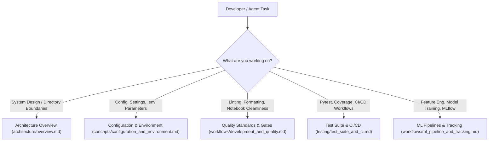

# Quickstart & Task Routing

Welcome to the machine learning project repository. This guide serves as the central entry point and navigation hub for developers and AI agents. It summarizes environment setup, core operational commands, code quality standards, and provides a task-routing map to direct you to domain-specific documentation across the wiki.

---

## Task Routing Map

When working on specific subsystems or tasks, refer to the navigation decision tree and routing table below to find the relevant technical documentation.


*Figure 1: Task-routing decision tree for navigating repository documentation.*

### Task Routing Matrix

| Task Category | Focus Area | Recommended Wiki Page | Primary Source References |
|---|---|---|---|
| **Architecture & Structure** | High-level system design, layer boundaries, directory organization, and raw-to-serving data flow. | [System Architecture & ML Pipeline Design](architecture/overview.md) | `src/`, `configs/`, `models/`, `docs/` |
| **Configuration & Environment** | Environment variables, `.env` loading, `pydantic-settings` management, directory path resolution, and default parameters. | [Environment Configuration & Settings Management](concepts/configuration_and_environment.md) | [`../src/utils/config.py`](../src/utils/config.py), [`../.env.example`](../.env.example) |
| **Quality & Standards** | Ruff linting rules, formatting, Radon/Xenon cyclomatic complexity thresholds, notebook cell output checking, and pre-commit hooks. | [Quality Standards, Quality Gates, & Notebook Hygiene](workflows/development_and_quality.md) | [`../pyproject.toml`](../pyproject.toml), [`../scripts/check_notebooks.py`](../scripts/check_notebooks.py), [`../.pre-commit-config.yaml`](../.pre-commit-config.yaml) |
| **Testing & CI/CD** | Pytest execution, test markers (`slow`, `integration`), coverage goals, and GitHub Actions workflow jobs (`quality`, `test`, `docker`). | [Test Suite & CI/CD Pipelines](testing/test_suite_and_ci.md) | [`../tests/`](../tests/), [`../.github/workflows/ci.yml`](../.github/workflows/ci.yml) |
| **ML Workflows & Tracking** | Feature engineering, model training pipelines, experiment tracking via MLflow (`sqlite:///mlflow.db`), and artifact management. | [ML Pipeline Structure & Experiment Tracking](workflows/ml_pipeline_and_tracking.md) | [`../src/pipelines/`](../src/pipelines/), [`../src/training/`](../src/training/), [`../src/features/`](../src/features/) |

---

## Environment Setup & Quickstart

The repository uses [`uv`](https://github.com/astral-sh/uv) for fast, reproducible Python dependency management and environment synchronization.

### 1. Initial Environment Configuration

Copy the sample environment configuration file to create your local `.env`:

```bash
cp .env.example .env
```

The default `.env` configuration initializes key settings:

```ini
ENV=local
LOG_LEVEL=INFO
RANDOM_SEED=42
MLFLOW_TRACKING_URI=sqlite:///mlflow.db
```

### 2. Dependency Installation

Install the required Python version, synchronize project dependencies, and set up git pre-commit hooks:

```bash
# Install Python runtime and sync dependencies
uv python install
uv sync

# Install pre-commit hooks for automated quality verification
uv run pre-commit install
```

---

## Core Development Commands

All development tasks—linting, formatting, complexity checks, notebook validation, and testing—are executed using `uv run`.

### Summary of Essential Commands

| Action | Command | Purpose |
|---|---|---|
| **Linting Check** | `uv run ruff check .` | Checks code against configured Ruff rules (`E`, `F`, `I`, `N`, `UP`, `D`, `B`, `SIM`). |
| **Format Check** | `uv run ruff format . --check` | Ensures code formatting complies with standard 88-character line lengths. |
| **Notebook Validation** | `uv run python scripts/check_notebooks.py` | Scans `.ipynb` files to ensure no executed outputs or cell execution counts remain. |
| **Clean Notebook Outputs** | `uv run nbstripout notebooks/**/*.ipynb` | Cleans output cells from Jupyter notebooks prior to commit. |
| **Complexity Summary** | `uv run radon cc src -a -s` | Analyzes cyclomatic complexity across modules in `src/`. |
| **Complexity Gate** | `uv run xenon --max-absolute B --max-modules A --max-average A src` | Asserts cyclomatic complexity boundaries (`absolute <= B`, `modules <= A`, `average <= A`). |
| **Run Unit & Integration Tests** | `uv run pytest` | Runs all tests using Pytest settings from `pyproject.toml`. |
| **Test Coverage Report** | `uv run pytest --cov --cov-report=term-missing` | Runs tests and generates a coverage summary for `src/` (excluding `src/main.py`). |
| **Run Application Entrypoint** | `uv run python src/main.py` | Executes the main pipeline entrypoint. |

---

## Continuous Integration & Automated Pipelines

Automated verification is governed by GitHub Actions configured in [`../.github/workflows/ci.yml`](../.github/workflows/ci.yml). The pipeline triggers on pushes and pull requests targeting the `main` and `development` branches, as well as on manual dispatch (`workflow_dispatch`).

### Workflow Jobs

1. **`quality` (Lint, format, complexity, and notebooks)**:
   - Installs Python and syncs dependencies with `uv sync --frozen`.
   - Runs `ruff check . --output-format=github` and `ruff format . --check`.
   - Runs `python scripts/check_notebooks.py` to reject executed notebooks.
   - Computes cyclomatic complexity with `radon cc src -a -s` and enforces strict gates with `xenon --max-absolute B --max-modules A --max-average A src`.

2. **`test` (Pytest & Coverage)**:
   - Depends on the successful completion of the `quality` job.
   - Executes `pytest --cov --cov-report=xml --cov-report=term-missing`.
   - Generates and uploads `coverage.xml` as a build artifact.

3. **`docker` (Container Image Build & Push)**:
   - Configured for GHCR (`ghcr.io`), but currently disabled via `if: false` until a root `Dockerfile` is added to the repository.

---

## Key Entrypoints & Directory Layout

Understanding where primary logic and configurations reside helps streamline navigation:

```
├── .github/workflows/   # GitHub Actions CI/CD workflows (ci.yml)
├── configs/             # External YAML/JSON configuration files
├── data/                # Data storage tiers (raw, interim, processed, features)
├── docs/                # Architecture documentation, ADRs, and model cards
├── models/              # Saved model artifacts and metadata
├── notebooks/           # Exploratory and report notebooks (must be output-free)
├── reports/figures/     # Generated plots and report artifacts
├── scripts/             # Maintenance and verification scripts (check_notebooks.py)
├── src/                 # Main Python source package
│   ├── api/             # Model serving and REST endpoint handlers
│   ├── data/            # Ingestion and raw data transformation code
│   ├── features/        # Feature extraction and engineering pipeline
│   ├── models/          # Model architecture implementations and serialization
│   ├── training/        # Training routines and loss functions
│   ├── pipelines/       # End-to-end training and inference orchestration
│   ├── utils/           # Configuration settings (config.py) and helpers
│   └── main.py          # Application entrypoint
└── tests/               # Test suite split into unit/ and integration/
```

- **Application Entrypoint**: [`../src/main.py`](../src/main.py) provides the entry function (`main()`) to trigger execution.
- **Central Settings**: [`../src/utils/config.py`](../src/utils/config.py) instantiates the global `settings` object via Pydantic `BaseSettings`.
- **Project Configuration**: [`../pyproject.toml`](../pyproject.toml) configures dependency groups (`dev`), Ruff linting/formatting rules, Pytest options, Pytest markers (`slow`, `integration`), and Coverage tracking settings.

---

## AI Agent Guidance & Operating Principles

AI agents operating in this repository should adhere to the guidelines set out in [`../AGENTS.md`](../AGENTS.md):

1. **Authoritative Source**: Treat the source code in `src/` and tests in `tests/` as the ultimate ground truth.
2. **Just-in-Time Context**: Use OpenWiki search and retrieval tools on demand when architectural uncertainties arise, rather than preloading the whole wiki.
3. **Quiet Validation**: Verify code changes with minimal, focused commands (e.g., `uv run pytest tests/unit/test_smoke.py` or `uv run ruff check .`) to keep failure output clear and actionable.
4. **Notebook Output Discipline**: Always run [`../scripts/check_notebooks.py`](../scripts/check_notebooks.py) or `nbstripout` if modifying Jupyter notebooks in `notebooks/` to prevent committing cell outputs.
