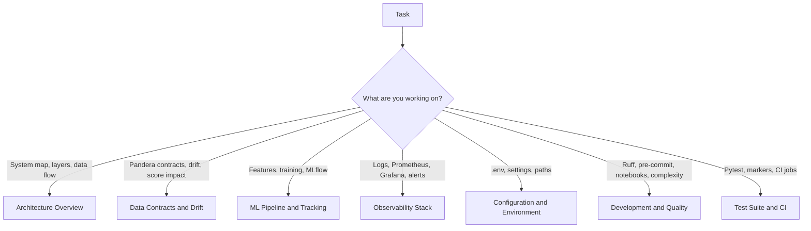
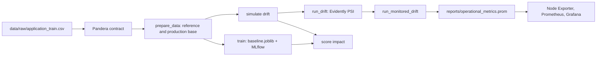

# Quickstart & Task Routing

This repository is the FIAP Tech Challenge Fase 4 project (Machine Learning Engineering). It simulates a fintech that uses a credit-scoring model and builds a reliability layer around it. The README objective list covers:

- Pandera data contracts.
- An XGBoost baseline tracked in MLflow.
- Evidently data-drift simulation and detection.
- Analysis of drift impact on predictions.
- Structured logs, Prometheus metrics and a Grafana dashboard.
- Automatic alert rules for drift and collector downtime.
- Governance, privacy and LGPD documentation.

The dataset is Home Credit Default Risk (Kaggle). It is a local artifact and is not versioned.

Use this page to set up the project, run it end to end, and find the right deeper page.

## Task Routing Map



| If you need to... | Read | Domain |
|---|---|---|
| Understand how data contracts, training, drift monitoring, score impact and observability fit together | [Architecture Overview](architecture/overview.md) | Architecture |
| Change or understand Pandera contracts, batch validation, Home Credit loading, drift simulation, the Evidently PSI monitor, or score-impact analysis | [Data Contracts, Drift Detection and Score Impact](concepts/data_contracts_and_drift.md) | Concepts |
| Change settings, `.env` values or directory resolution | [Environment Configuration & Settings Management](concepts/configuration_and_environment.md) | Concepts |
| Prepare data, engineer features, train the baseline, or read MLflow results | [ML Pipeline Structure & Experiment Tracking](workflows/ml_pipeline_and_tracking.md) | Workflows |
| Run or modify structured logging, Prometheus metrics, the Docker Compose stack, alert rules or the Grafana dashboard | [Observability Stack: Logging, Metrics, Prometheus and Grafana](operations/observability_stack.md) | Operations |
| Work with Ruff, pre-commit, Radon/Xenon gates or notebook hygiene | [Quality Standards, Quality Gates, & Notebook Hygiene](workflows/development_and_quality.md) | Workflows |
| Run or add tests, understand markers, coverage and the GitHub Actions jobs | [Test Suite & CI/CD Pipelines](testing/test_suite_and_ci.md) | Testing |

## Setup

Prerequisites (README): Python 3.12, Git, [uv](https://docs.astral.sh/uv/), and the dataset file. Docker with the Compose plugin is needed only for the observability stack, not for running the Python scripts.

```bash
uv python install 3.12
uv sync --locked
cp .env.example .env          # PowerShell: Copy-Item .env.example .env
uv run pre-commit install     # optional: enable local quality hooks
```

`.env.example` sets `ENV=local`, `LOG_LEVEL=INFO`, `RANDOM_SEED=42` and `MLFLOW_TRACKING_URI=sqlite:///mlflow.db`. The README copies `.env` "when needed", because `Settings` in [`../src/utils/config.py`](../src/utils/config.py) has defaults for every field. It also provides `data_dir` and `models_dir`, and ignores unknown variables. See [Configuration](concepts/configuration_and_environment.md).

Download `application_train.csv` from Kaggle and place it at `data/raw/application_train.csv`. Raw data, processed datasets and trained models are local and must not be pushed to GitHub.

## End-to-end run order

Run these from the repository root, in order (README "Executar o fluxo completo"):

```bash
uv run python -m scripts.validate_home_credit        # 1. validate input with Pandera
uv run python -m src.pipelines.prepare_data          # 2. reference / production-base split
uv run python -m src.training.train                  # 3. train + log baseline to MLflow
uv run python -m scripts.simulate_home_credit_drift  # 4. simulate drift in production data
uv run python -m scripts.run_drift                   # 5. Evidently PSI reports and alerts
uv run python -m scripts.analyze_score_impact        # 6. compare scores before/after drift
uv run python -m scripts.run_monitored_drift         # 7. validation + drift + .prom export
```



Key outputs:

- `data/processed/*.parquet`, `models/baseline.joblib` and `models/baseline_metrics.json`.
- `reports/drift_*.html` and `reports/drift_*.json`, `reports/drift_alerts.json` and `reports/score_impact.json`.
- `reports/operational_metrics.prom`, which Prometheus reads via Node Exporter's textfile collector.

Details live in [Data Contracts and Drift](concepts/data_contracts_and_drift.md) and [ML Pipeline](workflows/ml_pipeline_and_tracking.md).

Things to know before changing anything:

- The "production" data is a random split of the historical data, not a later time period.
- Drift is artificially simulated on two variables, `AMT_INCOME_TOTAL` and `AMT_CREDIT`.
- Scoring does not run Pandera validation on every call.
- `src/main.py` is only a placeholder entrypoint. Its `main()` prints a "project initialized" message, and it is excluded from coverage. The real entrypoints are the modules and scripts above.

## Observability stack

Python runs locally through `uv`. [`compose.observability.yaml`](../compose.observability.yaml) starts only Node Exporter, Prometheus and Grafana. It does not train the model or schedule drift runs. After step 7, set `GRAFANA_ADMIN_PASSWORD` and start the stack:

```bash
docker compose -f compose.observability.yaml up -d
```

Grafana is at `http://localhost:3000`, Prometheus at `http://localhost:9090` and Node Exporter at `http://localhost:9100`. Alerts are evaluated by Prometheus only; no Alertmanager notification channel is configured. The `.prom` file reflects the latest run only, so it can go stale. Setup, metrics, alert rules and troubleshooting are in [Observability Stack](operations/observability_stack.md).

## Quality and tests

```bash
uv run pytest -v
uv run ruff check .
uv run ruff format . --check
uv run python scripts/check_notebooks.py
uv run pre-commit run --all-files
uv run radon cc src -a -s
uv run xenon --max-absolute B --max-modules A --max-average A src
```

- **Ruff** enforces the `E`, `F`, `I`, `N`, `UP`, `D`, `B` and `SIM` rules at 88 columns with Google-style docstrings. Notebooks are excluded.
- **Radon/Xenon** gates run in CI over `src`.
- **Pre-commit** runs file-hygiene hooks, Ruff check and format, and `nbstripout`. A local `check-notebooks` hook then runs `scripts/check_notebooks.py` on changed `.ipynb` files.
- **`check_notebooks.py`** checks the notebook paths you pass, or every `notebooks/**/*.ipynb` if none are given. It lists code cells that have outputs or a non-null `execution_count`, exits with status 1 if any are found, and suggests `uv run nbstripout <notebook.ipynb>`.
- **CI** (`.github/workflows/ci.yml`) runs on pushes and PRs to `main` and `development`, and on manual dispatch.
  - A `quality` job runs Ruff, the notebook check and the Radon/Xenon gates.
  - A `test` job runs pytest with coverage and uploads `coverage.xml`.
  - The `docker` image-push job is disabled (`if: false`) until a root `Dockerfile` exists.

See [Development and Quality](workflows/development_and_quality.md) and [Test Suite & CI](testing/test_suite_and_ci.md).

## Agent guidance

[`../AGENTS.md`](../AGENTS.md) treats source code and tests as authoritative. It also asks agents to use OpenWiki retrieval just in time, run the narrowest quiet validation, and not hand-edit generated wiki pages.
