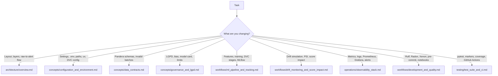

# Quickstart & Task Routing

This repository is the FIAP "Tech Challenge Fase 4" project. It is a reliability layer around a **Home Credit Default Risk** credit-scoring model. The pieces are:

- Pandera data contracts.
- An XGBoost baseline tracked in MLflow.
- Evidently PSI drift detection on simulated production data.
- Score-impact analysis.
- Structured logs and Prometheus metrics, shown in Grafana with alert rules.
- Governance and LGPD documentation.

It is a **batch** project. Python scripts run locally through `uv` and exit. Docker Compose starts only Prometheus, Node Exporter and Grafana. It does not train the model or schedule the drift run.

Use this page to set up quickly and to find the wiki page for your task.

## Task routing


*Figure 1: Decision tree from a task to the wiki page that owns it.*

| If you need to... | Read | Key places in the repo |
|---|---|---|
| Understand package boundaries and the raw-to-alert data flow | [System Architecture](architecture/overview.md) | `src/`, `scripts/`, `data/`, `models/`, `reports/`, `infra/` |
| Change environment variables, paths, Python or uv setup, DVC config | [Environment Configuration](concepts/configuration_and_environment.md) | `src/utils/config.py`, `.env.example`, `.dvc/config` |
| Edit or debug Pandera contracts and the invalid-batch demo | [Data Contracts](concepts/data_contracts.md) | `src/data/contracts.py`, `src/monitoring/validation.py` |
| Check privacy, LGPD, fairness or limitation constraints before touching data or model handling | [Governance & LGPD](concepts/governance_and_lgpd.md) | `docs/`, README governance sections |
| Change features, training, DVC stages or MLflow tracking | [ML Pipeline & Tracking](workflows/ml_pipeline_and_tracking.md) | `dvc.yaml`, `src/features/`, `src/training/`, `src/pipelines/prepare_data.py` |
| Change drift simulation, Evidently/PSI alerts or score-impact analysis | [Drift & Score Impact](workflows/drift_monitoring_and_score_impact.md) | `src/data/simulate_drift.py`, `src/pipelines/drift_monitor.py`, `src/pipelines/score_impact.py` |
| Change metrics, JSON logs, Prometheus, Grafana or alert rules | [Observability Stack](operations/observability_stack.md) | `src/monitoring/`, `compose.observability.yaml`, `infra/observability/` |
| Understand lint, complexity and notebook gates | [Quality Standards & Gates](workflows/development_and_quality.md) | `pyproject.toml`, `.pre-commit-config.yaml`, `scripts/check_notebooks.py` |
| Add tests or understand CI and the OpenWiki workflows | [Test Suite & CI/CD](testing/test_suite_and_ci.md) | `tests/`, `.github/workflows/` |

## Setup

Prerequisites: Python 3.12, Git and [uv](https://docs.astral.sh/uv/). Docker with Compose is needed only for the observability stack. `pyproject.toml` declares `requires-python = ">=3.12"`.

```bash
uv python install 3.12
uv sync --locked          # runtime + dev group (dvc, pytest, ruff, radon, xenon, nbstripout, pre-commit)
cp .env.example .env      # optional; PowerShell: Copy-Item .env.example .env
uv run pre-commit install
```

- `.env.example` defines `ENV=local`, `LOG_LEVEL=INFO`, `RANDOM_SEED=42` and `MLFLOW_TRACKING_URI=sqlite:///mlflow.db`.
- `src/utils/config.py` loads `.env` from the repository root through Pydantic `BaseSettings` and ignores unknown keys. The defaults also cover `data_dir` and `models_dir`. If `MLFLOW_TRACKING_URI` is not set, it defaults to a SQLite file at the repo root.
- Details are in [Environment Configuration](concepts/configuration_and_environment.md).

### Data and DVC

1. Download `application_train.csv` from the Kaggle Home Credit Default Risk competition and place it at `data/raw/application_train.csv`.
2. DVC tracks the CSV through `data/raw/application_train.csv.dvc`, which stores only the hash.
3. `.dvc/config` currently sets only `autostage = true`. **No DVC remote is configured**, so `dvc pull` has nothing to pull from. Each person downloads the CSV manually.
4. Raw data, processed Parquet files and trained models are local artifacts and must not be pushed to GitHub.

## Running the pipeline

`dvc.yaml` declares six stages in this order: `validate`, `prepare_data`, `train`, `simulate_drift`, `detect_drift`, `score_impact`. Each stage runs one module with `uv run python -m ...`. Metrics and reports are written to `models/` and `reports/`.

```bash
uv run dvc repro          # run only stale stages
uv run dvc status
uv run dvc metrics show   # training, drift-alert and score-impact metrics
uv run dvc dag
```

Commit `dvc.lock` together with the changes that produced it.

The manual order, which the README also documents, is below. The last step is **not** a DVC stage.

```bash
uv run python -m scripts.validate_home_credit
uv run python -m src.pipelines.prepare_data
uv run python -m src.training.train
uv run python -m scripts.simulate_home_credit_drift
uv run python -m scripts.run_drift
uv run python -m scripts.analyze_score_impact
uv run python -m scripts.run_monitored_drift   # validation + drift + reports/operational_metrics.prom
```

`scripts.demo_invalid_batch` shows Pandera rejecting a deliberately corrupted batch.

To view the metrics, set `GRAFANA_ADMIN_PASSWORD` in your shell, then run `docker compose -f compose.observability.yaml up -d`. Prometheus is at `localhost:9090` and Grafana at `localhost:3000`. See [Observability Stack](operations/observability_stack.md) for ports, rules and troubleshooting.

`src/main.py` is only a placeholder entrypoint. Its `main()` prints a startup message, and coverage omits it. Real work happens in the modules and scripts above.

## Quality commands

```bash
uv run pytest -v
uv run ruff check .
uv run ruff format . --check
uv run python scripts/check_notebooks.py
uv run pre-commit run --all-files
uv run radon cc src -a -s
uv run xenon --max-absolute B --max-modules A --max-average A src
```

- **Ruff**: configured in `pyproject.toml` with line length 88, target `py312`, rules `E F I N UP D B SIM` and Google docstring convention. Docstring rules are ignored under `tests/**`. `notebooks/` is excluded from Ruff.
- **Radon and Xenon**: no thresholds live in `pyproject.toml`. The complexity gate is the Xenon command above, run in the `quality` CI job and available locally. It is not a pre-commit hook.
- **Pytest**: `testpaths = ["tests"]`, `--strict-markers`, markers `slow` and `integration`. Coverage covers `src` minus `src/main.py`, with `fail_under = 0`.
- **Notebook hygiene**:
  - `scripts/check_notebooks.py` scans the paths you pass, or every `notebooks/**/*.ipynb` if you pass none.
  - It flags *code* cells that have non-empty `outputs` or a non-null `execution_count`. It prints the cell indices.
  - It exits 1 if any notebook is dirty and 0 otherwise. The fix is `uv run nbstripout <notebook.ipynb>`.
- **Pre-commit** runs file-hygiene hooks, `ruff-check --fix`, `ruff-format`, `nbstripout` and a local `check-notebooks` hook for `.ipynb` files. The hygiene hooks include `detect-private-key` and a 1000 KB large-file limit.
- **CI** (`ci.yml`, named CI/CD) runs on pushes and pull requests to `main` and `development`, and on manual dispatch. The `quality` job runs Ruff, `check_notebooks.py`, Radon and Xenon. The `test` job needs `quality`, runs pytest with coverage and uploads `coverage.xml`. The `docker` GHCR job is disabled (`if: false`) until a root `Dockerfile` exists.

See [Quality Standards & Gates](workflows/development_and_quality.md) and [Test Suite & CI/CD](testing/test_suite_and_ci.md) for details.

Commit message convention: `feat`, `fix`, `docs`, `refactor`, `test`, `chore`.

## Agent guidance

`AGENTS.md` makes OpenWiki optional, just-in-time context. Do not preload the wiki. Treat source and tests as authoritative, and prefer the narrowest quiet validation that proves your change. The generated OpenWiki pages are refreshed by workflow, so do not hand-edit them unless asked.
