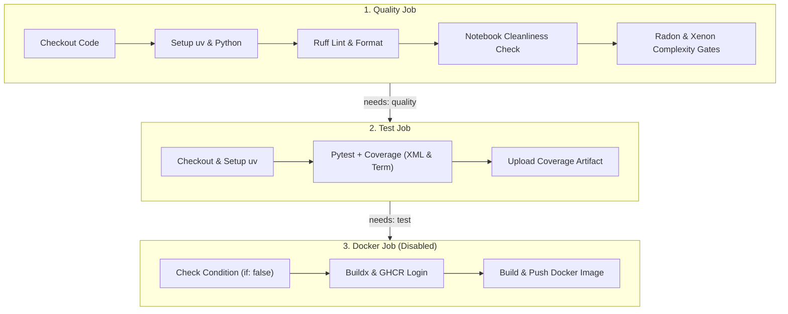

# Test Suite & CI/CD Pipelines

The repository employs an automated testing and continuous integration (CI/CD) pipeline designed to guarantee code quality, verify configuration integrity, enforce complexity bounds, and build deployment artifacts.

Testing execution is driven by [Pytest](https://docs.pytest.org/), while static analysis, code formatting, notebook cleaning, and cyclomatic complexity gates ensure quality prior to containerization and registry publishing via GitHub Actions.

---

## Testing Strategy & Directory Structure

The test suite is structured into unit and integration suites under the `tests/` directory:

```
tests/
├── __init__.py
├── unit/
│   ├── __init__.py
│   └── test_smoke.py
└── integration/
    └── __init__.py
```

### Test Hierarchy

* **Unit Tests (`tests/unit/`)**: Verify individual functions, modules, and configuration loading in isolation without external dependencies.
* **Integration Tests (`tests/integration/`)**: Test interactions between system components, data processing modules, model training workflows, or external APIs.
* **Smoke Tests (`tests/unit/test_smoke.py`)**: Function as initial sanity checks ensuring that the environment and configuration settings initialize properly. The `test_settings_carrega` smoke test imports global settings from `src.utils.config` and asserts default values such as `settings.random_seed == 42` and `settings.data_dir.name == "data"`.

For details on how environment settings are loaded and managed, refer to [Configuration & Environment](../concepts/configuration_and_environment.md).

---

## Pytest & Coverage Configuration

Pytest and coverage settings are configured centrally in `pyproject.toml`.

### Pytest Configuration (`[tool.pytest.ini_options]`)

```toml
[tool.pytest.ini_options]
testpaths = ["tests"]
pythonpath = ["."]
addopts = "-ra --strict-markers"
markers = [
    "slow: testes demorados",
    "integration: testes de integração",
]
```

Key configuration parameters include:
* **`testpaths = ["tests"]`**: Restricts test discovery to the `tests/` directory.
* **`pythonpath = ["."]`**: Adds the repository root to Python's search path, allowing clean absolute imports (e.g., `from src.utils.config import settings`) without requiring package installation in editable mode during local runs.
* **`addopts = "-ra --strict-markers"`**:
  * `-ra`: Displays extra test summary information for all test results except passed tests (failed, skipped, xfailed, xpassed, warnings).
  * `--strict-markers`: Disallows unregistered markers, preventing typos when marking tests.
* **Custom Markers**:
  * `@pytest.mark.slow`: Identifies execution-heavy or long-running tests.
  * `@pytest.mark.integration`: Marks integration tests that touch file systems, databases, or external integrations.

### Coverage Configuration (`[tool.coverage]`)

Coverage monitoring is managed by `pytest-cov` and configured in `pyproject.toml`:

```toml
[tool.coverage.run]
source = ["src"]
omit = ["src/main.py"]

[tool.coverage.report]
show_missing = true
fail_under = 0
```

* **Source Tracking (`source = ["src"]`)**: Restricts coverage measurement to source code within `src/`.
* **Omissions (`omit = ["src/main.py"]`)**: Excludes top-level application entry points that are evaluated interactively or via CLI commands.
* **Reporting Options**: `show_missing = true` outputs exact line numbers missing coverage during test execution. `fail_under = 0` sets the minimum baseline, which can be scaled upward as production logic matures.

---

## CI/CD Pipeline Architecture

The continuous integration and continuous delivery workflow is defined in `.github/workflows/ci.yml`.

### Triggers & Concurrency

The workflow executes under the following conditions:
* **Pushes** to `main` or `development` branches.
* **Pull Requests** targeting `main` or `development` branches.
* **Manual execution** via `workflow_dispatch`.

To prevent redundant execution and save CI compute resources, concurrency control cancels superseded runs on the same branch or PR ref:
```yaml
concurrency:
  group: ${{ github.workflow }}-${{ github.ref }}
  cancel-in-progress: true
```

### Stage Pipeline Flow

The workflow consists of three sequential jobs: `quality` -> `test` -> `docker`. Note that the `docker` job is currently disabled via `if: false`.


*Continuous integration pipeline stages and conditional execution gates.*

### Pipeline Job Details

#### 1. `quality` Job
* **Purpose**: Enforces code style, prevents dirty Jupyter notebooks, and maintains software maintainability thresholds.
* **Steps**:
  1. Sets up Python using `astral-sh/setup-uv@v6` with dependency caching (`enable-cache: true`).
  2. Synchronizes dependencies frozen via `uv sync --frozen`.
  3. **Linting**: Executes `uv run ruff check . --output-format=github`.
  4. **Formatting**: Checks code format with `uv run ruff format . --check`.
  5. **Notebook Validation**: Runs `uv run python scripts/check_notebooks.py` to ensure Jupyter notebooks in `notebooks/` have no executed cell outputs or `execution_count` fields stored in version control.
  6. **Complexity Analysis**: Computes cyclomatic complexity using `uv run radon cc src -a -s`.
  7. **Complexity Quality Gate**: Enforces maintainability using `uv run xenon --max-absolute B --max-modules A --max-average A src`.

#### 2. `test` Job
* **Prerequisite**: Depends on `needs: quality`.
* **Purpose**: Runs unit and integration test suites and measures code coverage.
* **Steps**:
  1. Prepares Python environment via `uv sync --frozen`.
  2. Executes Pytest with coverage reporting:
     ```bash
     uv run pytest --cov --cov-report=xml --cov-report=term-missing
     ```
  3. Uploads `coverage.xml` as a GitHub Actions artifact named `coverage` via `actions/upload-artifact@v4`.

#### 3. `docker` Job
* **Prerequisite**: Depends on `needs: test`.
* **Conditional Gate**: Currently disabled with `if: false` until a `Dockerfile` exists at the root of the repository. (The workflow retains a commented restore condition `# if: github.event_name == 'push' && github.ref == 'refs/heads/main'` for future activation).
* **Permissions**: Configured with `contents: read` and `packages: write` permissions.
* **Purpose**: Packages the application into a container image and publishes it to GitHub Container Registry (GHCR) when enabled.
* **Steps**:
  1. Checks out repository (`actions/checkout@v4`).
  2. Configures Docker Buildx (`docker/setup-buildx-action@v3`).
  3. Logs into `ghcr.io` using GitHub actor credentials and secret `GITHUB_TOKEN` (`docker/login-action@v3`).
  4. Generates metadata tags based on Git SHA (`type=sha`) and `latest` (`docker/metadata-action@v5`).
  5. Builds and pushes the image (`docker/build-push-action@v6`) using GitHub Actions cache (`type=gha`).

---

## Local Development & Quality Tools

Quality enforcement in CI matches local developer workflows described in [Development & Quality Workflows](../workflows/development_and_quality.md):

* **Pre-commit Hooks**: Defined in `.pre-commit-config.yaml`, executing standard hygiene checks, `ruff-check`, `ruff-format`, `nbstripout`, and the local `check-notebooks` hook prior to committing code.
* **Notebook Cleaning**: Developer notebook hygiene is enforced both pre-commit via `nbstripout` and during CI checks via `scripts/check_notebooks.py`.
