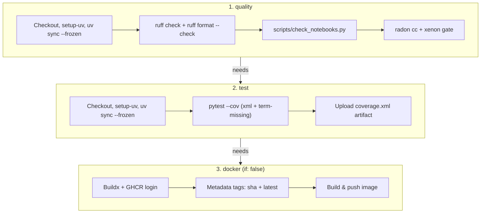

# Test Suite & CI/CD Pipelines

The repository combines a pytest unit suite with GitHub Actions automation. The suite checks feature engineering, the baseline model, Pandera data contracts, drift simulation and the monitoring layer. The `ci.yml` workflow gates every push and pull request with lint, format, notebook-hygiene and complexity checks, then runs the tests with coverage. Three further workflows generate and publish the OpenWiki documentation.

---

## Test Suite Layout

```
tests/
├── __init__.py
├── unit/
│   ├── __init__.py
│   ├── conftest.py                  # synthetic Home Credit generator + hc_df fixture
│   ├── test_smoke.py                # config loads
│   ├── test_features.py             # src.features.build
│   ├── test_baseline.py             # src.models.baseline + src.training.train
│   ├── test_contracts.py            # src.data.contracts (Pandera)
│   ├── test_prepare_data.py         # src.pipelines.prepare_data
│   ├── test_drift.py                # src.data.simulate_drift
│   ├── test_drift_monitor.py        # src.pipelines.drift_monitor (PSI alerts)
│   ├── test_score_impact.py         # src.pipelines.score_impact
│   ├── test_monitoring_metrics.py   # src.monitoring.metrics (Prometheus)
│   ├── test_validation_monitoring.py# src.monitoring.validation
│   ├── test_logging_config.py       # src.monitoring.logging_config
│   └── test_run_monitored_drift.py  # scripts/run_monitored_drift.py
└── integration/
    └── __init__.py                  # placeholder, no tests yet
```

All real tests currently live in `tests/unit/`, roughly one file per `src/` module (plus one for the `scripts/run_monitored_drift.py` entry point). `tests/integration/` exists only as an empty package.

### Shared fixture: synthetic Home Credit data

`tests/unit/conftest.py` defines `make_home_credit(n=4000, seed=0)`. It builds a seeded, synthetic frame in the `application_train` shape and returns it restricted to `RAW_COLUMNS` from `src.features.build`. The `hc_df` fixture wraps it, so no real dataset is needed.

The generator deliberately includes realistic quirks that the code under test must handle:
* a `TARGET` drawn from a logistic function of `EXT_SOURCE_2` and `EXT_SOURCE_3`, which gives the baseline model learnable signal;
* the `DAYS_EMPLOYED == 365243` sentinel on about one sixth of rows;
* missing values in `EXT_SOURCE_1` (a third of rows), `AMT_ANNUITY` (20 rows) and `OCCUPATION_TYPE` (a quarter of rows);
* a `CODE_GENDER` value `XNA` at about 1%, which feeds the fairness-grouping tests.

`test_prepare_data.py` imports `make_home_credit` directly from `tests.unit.conftest`, which works because `tests/` and `tests/unit/` are packages and the repository root is on `pythonpath`.

### What each area verifies

| Area | Representative behavior asserted |
|---|---|
| Smoke (`test_smoke.py`) | `settings.random_seed == 42` and `settings.data_dir.name == "data"` from `src.utils.config` (see [Configuration & Environment](../concepts/configuration_and_environment.md)). |
| Features | Output has only model columns; the `DAYS_EMPLOYED` sentinel becomes null; financial ratios follow income changes; division by zero becomes null. |
| Baseline model | AUC above 0.65 and a KS statistic and threshold within (0, 1); per-gender AUC metrics exist but exclude the `XNA` group; scores are probabilities that keep the input index; unseen categories do not break scoring; `CODE_GENDER` is not a model feature; save/load round-trips scores and threshold (with `models_dir` monkeypatched to `tmp_path`); groups too small are ignored. |
| Data contracts | Valid training batch passes; negative income, zero credit, implausible `DAYS_BIRTH`, negative `CNT_CHILDREN` and out-of-range `TARGET` raise `SchemaErrors` naming the failing column; duplicate `SK_ID_CURR` is rejected; null `AMT_ANNUITY` is accepted; inference batches do not need `TARGET`. See [Data Contracts](../concepts/data_contracts.md). |
| Data preparation | Reference and production splits are disjoint, cover all 4000 rows, and have similar `TARGET` means; invalid data raises and leaves no `processed/` directory; a missing CSV raises a `FileNotFoundError` that names `application_train.csv`. |
| Drift simulation | Exactly 12 of 20 rows are changed, with income ×1.40 and credit ×1.30; IDs and `TARGET` are untouched; the same seed gives the same output and does not mutate the input; the result still satisfies the training contract; invalid fractions (0, -0.1, 1.5) are rejected. |
| Drift alerts | `extract_psi_alerts` flags PSI at or above the 0.20 threshold (0.05 no, 0.20 and 0.35 yes); a report without drift metrics raises `ValueError`. |
| Score impact | Before and after scores are aligned by `SK_ID_CURR` rather than row order (verified with a deliberately reversed frame and a `FakeModel`); changed-decision counts are computed against the threshold; mismatched IDs, duplicate IDs and out-of-range thresholds raise `ValueError`. See [Drift Monitoring & Score Impact](../workflows/drift_monitoring_and_score_impact.md). |
| Monitoring | See below. |

### Monitoring tests

The monitoring tests use isolated Prometheus `CollectorRegistry` instances built via `build_metrics(registry)`. They assert on `registry.get_sample_value(...)` instead of the global registry, so tests do not leak state into each other. The metric names and labels they pin down are described in [Observability Stack](../operations/observability_stack.md).
* `test_monitoring_metrics.py`: `observe_pipeline` records `credit_pipeline_runs_total{status="success"|"error"}` and a duration histogram, and re-raises the original exception on failure. `record_psi` stores `credit_data_drift_psi{feature=...}` and rejects negative PSI.
* `test_validation_monitoring.py`: `validate_training_with_monitoring` logs `status="approved"` with a record count and counts a `data_validation` success. For an invalid batch it logs `status="rejected"` with `error_type="SchemaErrors"`, counts an error and still raises, so monitoring never swallows the Pandera block.
* `test_logging_config.py`: `JsonFormatter` emits JSON with `level`, `message`, `timestamp` and the `extra` fields (`event`, `status`, `records`, `pipeline`).
* `test_run_monitored_drift.py`: runs `scripts.run_monitored_drift.main()` with `REPORT_DIR`, `load_application_train` and `run_drift_main` monkeypatched, then reads the textfile output `operational_metrics.prom`. Three behaviours are verified:
  1. A successful run exports `data_loading`, `data_validation` and `drift_monitor` successes, durations and PSI values taken from `drift_alerts.json`.
  2. A failing drift run re-raises, records `drift_monitor` `status="error"`, and still writes the metrics file.
  3. An invalid batch (zero `AMT_CREDIT`) blocks the drift step: the fake drift runner calls `pytest.fail` if it is ever reached, and `SchemaErrors` propagates.

### Test conventions

* Tests isolate the filesystem and settings with `tmp_path` and `monkeypatch` (for example `settings.data_dir` and `settings.models_dir`).
* Heavy collaborators are replaced with fakes (`FakeModel`, `fake_run`) instead of training or running Evidently.
* `pytest.mark.parametrize` is used for contract violations, PSI thresholds and invalid fractions.
* The `slow` and `integration` markers are registered but no test currently uses them.
* Ruff ignores the docstring rules (`D`) for `tests/**`, so many tests have no docstrings.

---

## Pytest & Coverage Configuration

Configuration lives in `pyproject.toml`.

```toml
[tool.pytest.ini_options]
testpaths = ["tests"]
pythonpath = ["."]
addopts = "-ra --strict-markers"
markers = [
    "slow: testes demorados",
    "integration: testes de integração",
]

[tool.coverage.run]
source = ["src"]
omit = ["src/main.py"]

[tool.coverage.report]
show_missing = true
fail_under = 0  # suba para 70+ quando houver código de verdade
```

* **`testpaths`** limits discovery to `tests/`.
* **`pythonpath = ["."]`** puts the repository root on `sys.path`. This is why tests can import `src.*`, `scripts.*` and `tests.unit.conftest` without installing the project.
* **`-ra --strict-markers`** prints a summary of every non-passing outcome and rejects unregistered markers.
* **Markers** `slow` and `integration` are registered for future use.
* **Coverage** measures only `src/` and omits `src/main.py`. `show_missing` lists uncovered lines. `fail_under = 0` means coverage is reported but does not gate the build. The inline comment says to raise it to 70 or more once there is real code.
* The dev dependency group provides `pytest`, `pytest-cov`, `radon`, `xenon`, `ruff`, `pre-commit` and `nbstripout`.

Run locally:

```bash
uv sync --frozen
uv run pytest --cov --cov-report=term-missing
```

---

## CI/CD Pipeline (`ci.yml`)

The workflow is named **CI/CD**.

### Triggers & concurrency

* Pushes and pull requests targeting `main` or `development`, plus manual `workflow_dispatch`.
* Concurrency group `${{ github.workflow }}-${{ github.ref }}` with `cancel-in-progress: true`, so a newer commit on the same ref cancels the older run.

### Job flow

Three sequential jobs run in the order `quality` → `test` → `docker`. The `docker` job is currently disabled with `if: false`.



#### `quality`
Uses `astral-sh/setup-uv@v6` with caching, then `uv python install` and `uv sync --frozen`. Steps:
1. `uv run ruff check . --output-format=github`
2. `uv run ruff format . --check`
3. `uv run python scripts/check_notebooks.py`, which fails if notebooks contain stored outputs.
4. `uv run radon cc src -a -s`, a complexity report.
5. `uv run xenon --max-absolute B --max-modules A --max-average A src`, a complexity gate. Every block must be rank B or better, every module A, and the average A.

Ruff selects `E, F, I, N, UP, D, B, SIM` with Google docstring convention at line length 88, and excludes `notebooks/`.

#### `test`
Depends on `quality`. It repeats the environment setup and runs `uv run pytest --cov --cov-report=xml --cov-report=term-missing`. It then uploads `coverage.xml` as the `coverage` artifact. Because `fail_under = 0`, only test failures fail this job.

#### `docker`
Depends on `test` and carries `contents: read` and `packages: write` permissions. It is guarded by `if: false` until a `Dockerfile` exists at the repository root. A comment keeps the intended condition, `github.event_name == 'push' && github.ref == 'refs/heads/main'`. When enabled it sets up Buildx, logs in to `ghcr.io` with `GITHUB_TOKEN`, tags the image `ghcr.io/<repo>` with `type=sha` and `latest`, and builds and pushes with the GitHub Actions cache (`type=gha`).

### Local parity

The same checks run before commit through `.pre-commit-config.yaml`: file hygiene hooks (including `detect-private-key` and a 1000 KB large-file limit), `ruff-check --fix`, `ruff-format`, `nbstripout`, and a local `check-notebooks` hook. Complexity and tests are CI-only. See [Development & Quality Workflows](../workflows/development_and_quality.md).

---

## OpenWiki Workflows

Three workflows keep the generated `openwiki/` documentation current and published. All pin third-party actions by commit SHA and install `openwiki@0.7.2` with Node 22.

| Workflow | Triggers | Responsibility |
|---|---|---|
| `openwiki-ci.yml` (OpenWiki CI/CD) | push or pull request to `main`/`development` (ignoring changes under `openwiki/**`), `workflow_dispatch` | Generate or update the wiki on code changes. |
| `openwiki-update.yml` (OpenWiki Update) | daily cron `0 8 * * *`, `workflow_dispatch` | Scheduled `openwiki code --update`, delivered as a PR. |
| `openwiki-pages.yml` (OpenWiki Pages) | push to `main`/`development` touching `openwiki/**` or the workflow file, `workflow_dispatch` | Export and publish the static visualizer to GitHub Pages. |

### `openwiki-ci.yml`: per-change generation

1. **Guards.** The job is skipped for fork pull requests, because they have no secrets or push rights, and for PR branches named `openwiki/*`. `paths-ignore: openwiki/**` stops a merged wiki-only PR from retriggering generation. A first step fails fast if the `ANTHROPIC_API_KEY` secret is missing.
2. **Checkout.** It uses full history (`fetch-depth: 0`), because `openwiki code --update` diffs against the last documented commit. For pull requests it checks out the head branch, not the merge commit, so it can push back to it.
3. **Mode selection.** It runs `openwiki code --init --print` when `openwiki/.last-update.json` is absent. Otherwise it runs `--update`. The provider is Anthropic, with the model set through `OPENWIKI_MODEL_ID`. LangSmith tracing is switched on only when `LANGSMITH_API_KEY` exists, since sending traces without it returns 403. The run step uses `continue-on-error`, so partial output is kept.
4. **Cleanup and path list.** It deletes the transient `openwiki/.run.json`. It stages only `openwiki`, `AGENTS.md` and `CLAUDE.md` (if present). Workflow files are excluded because `GITHUB_TOKEN` cannot modify `.github/workflows`.
5. **Delivery.**
   * On push or dispatch, `peter-evans/create-pull-request` opens or updates branch `openwiki/update-<branch>` with base `<branch>`.
   * On pull requests, the bot commits `docs: update OpenWiki` directly to the PR branch, or does nothing if there is no diff.
6. **Failure propagation.** A final step exits 1 if OpenWiki itself failed. The PR or commit still keeps whatever pages finished, and merging it makes that progress the baseline for the next run.

Its concurrency group is `openwiki-<head_ref or ref_name>` with `cancel-in-progress: false`, so in-flight generation is never discarded.

### `openwiki-update.yml`: scheduled refresh

It runs `openwiki code --update --print` every day at 08:00 UTC, or on manual dispatch. It always enables LangSmith tracing (`LANGCHAIN_TRACING_V2: "true"`). It stages `openwiki`, `AGENTS.md`, `CLAUDE.md` (if present) and its own workflow file, and opens a single PR on branch `openwiki/update` titled `docs: update OpenWiki`. As in the CI variant, a failed run still produces a PR with the completed pages, and the job is then marked failed.

### `openwiki-pages.yml`: static site publishing

* The `build` job checks out `main` into `src-main` and `development` into `src-development`. For each branch that has an `openwiki/` directory, it runs `openwiki visualize <dir> --export`.
* GitHub Pages serves one site per repository and each deploy replaces it, so every deploy assembles both versions: `main` at the site root and `development` under `/development/`. If `main` has no wiki, the root becomes a redirect to `./development/`. If neither branch has one, the job fails.
* The `deploy` job (`needs: build`) publishes the `_site` artifact through `actions/deploy-pages` into the `github-pages` environment. It requires the repository's Pages source to be set to GitHub Actions and the environment to allow both branches.
* Concurrency group `openwiki-pages` with no cancellation serializes deploys.

### How the pieces fit

Code pushes trigger `ci.yml` (quality and tests) and `openwiki-ci.yml` (wiki PR) independently. Merging the resulting wiki-only PR does not retrigger generation because of `paths-ignore`. It does trigger `openwiki-pages.yml`, which republishes the site. The daily `openwiki-update.yml` is a safety net that catches drift between code and docs.
