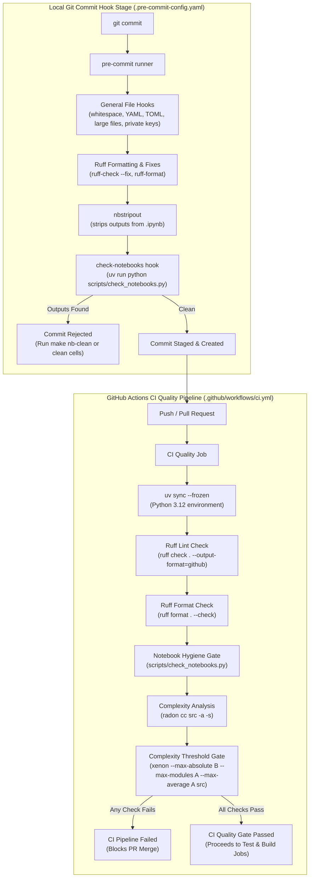

# Quality Standards, Quality Gates, & Notebook Hygiene

Maintaining high standards for code readability, architectural simplicity, and environment reproducibility is fundamental to this project. The repository enforces these standards through an automated, multi-tiered quality control strategy combining static code analysis, cyclomatic complexity thresholds, Git pre-commit hooks, Jupyter notebook hygiene checks, and Continuous Integration (CI) quality gates.

---

## Architectural Quality Strategy

Code quality enforcement is divided into two execution tiers: **local pre-commit automation** (enforcing formatting, auto-fixes, and notebook cleaning before code enters Git) and **CI pipeline verification** (enforcing strict compliance, cyclomatic complexity limits, and test coverage before pull requests can be merged).


*Figure 1: Dual-tier quality enforcement workflow across local pre-commit hooks and GitHub Actions CI pipelines.*

---

## Static Analysis & Code Formatting (Ruff)

Python code formatting and static analysis are managed centrally by [Ruff](https://docs.astral.sh/ruff/), an extremely fast Python linter and formatter.

### Ruff Configuration

Ruff settings are configured in [`pyproject.toml`](../../pyproject.toml):

```toml
[tool.ruff]
line-length = 88
target-version = "py312"
extend-exclude = ["notebooks/"]
force-exclude = true

[tool.ruff.lint]
select = ["E", "F", "I", "N", "UP", "D", "B", "SIM"]

[tool.ruff.lint.pydocstyle]
convention = "google"

[tool.ruff.lint.per-file-ignores]
"tests/**" = ["D"]
```

### Key Policy Rules

* **Line Length**: Set to `88` characters to match standard Black/Ruff formatting guidelines.
* **Target Python Version**: Configured for `py312` (Python 3.12).
* **Notebook Exclusions**: Notebooks located under `notebooks/` are explicitly excluded (`extend-exclude = ["notebooks/"]` and `force-exclude = true`) to prevent formatting rules from altering rapid exploratory notebook code.
* **Enabled Linter Rules (`select`)**:
  * `E`: Pycodestyle error rules.
  * `F`: Pyflakes checks (detecting syntax errors, undefined variables, and unused imports).
  * `I`: `isort` rule set for enforcing consistent import sorting order.
  * `N`: `pep8-naming` rules for consistent naming of functions, classes, and variables.
  * `UP`: `pyupgrade` checks to modernize Python code constructs for Python 3.12 compatibility.
  * `D`: `pydocstyle` checks enforcing docstring formatting.
  * `B`: `flake8-bugbear` checks for common bug risks and anti-patterns.
  * `SIM`: `flake8-simplify` checks suggesting simpler, more Pythonic expressions.
* **Docstring Convention**: Docstrings must follow the Google style guide (`convention = "google"`). Docstring validation is disabled for test files under `tests/**` (`"tests/**" = ["D"]`) to avoid unnecessary documentation overhead on unit and integration tests.

---

## Cyclomatic Complexity Control (Radon & Xenon)

To ensure the codebase remains maintainable and prevent modular complexity creep, the repository enforces strict Cyclomatic Complexity (CC) bounds using **Radon** and **Xenon**.

### Complexity Measurement (Radon)

Radon calculates the cyclomatic complexity of functions, methods, and classes across source code files. In CI, Radon computes and logs complexity scores for all modules in `src/`:

```bash
uv run radon cc src -a -s
```

* `-a`: Calculates average complexity across all analyzed modules.
* `-s`: Displays complexity grades alongside scores.

Complexity scores are categorized into letter ranks:
* **Rank A (1–5)**: Low complexity, simple and well-structured code.
* **Rank B (6–10)**: Moderate complexity, well-factored code.
* **Rank C (11–20)**: High complexity, candidates for refactoring.
* **Rank D–F (>20)**: Severe complexity, high risk of bugs and difficult maintainability.

### Complexity Quality Gate (Xenon)

While Radon provides report output, **Xenon** acts as an absolute pass/fail quality gate. The CI quality pipeline enforces strict complexity bounds via the following command:

```bash
uv run xenon --max-absolute B --max-modules A --max-average A src
```

* `--max-absolute B`: No individual function, class method, or top-level code block in `src/` may exceed rank B (maximum score of 10). Any method reaching rank C or higher fails the pipeline.
* `--max-modules A`: The average complexity of methods within any single module in `src/` must not exceed rank A (maximum score of 5).
* `--max-average A`: The overall average complexity across all modules in `src/` must not exceed rank A (maximum score of 5).

---

## Notebook Output Hygiene & State Validation

Jupyter notebooks (`.ipynb`) are valuable for exploratory analysis and visualization, but committing executed notebooks into Git introduces significant problems:
1. **Git Bloat & Noise**: Binary plot outputs (PNG/HTML) and execution state metadata cause unreadable, massive pull request diffs.
2. **Security & Information Leakage**: Executed outputs may accidentally expose sensitive variables, local file paths, API tokens, or internal data samples.
3. **Reproducibility Risks**: Stale cell execution numbers (`execution_count`) obscure whether code runs sequentially without error from top to bottom.

To address these risks, the repository enforces a strict **clean state requirement** using two complementary tools: `nbstripout` and [`scripts/check_notebooks.py`](../../scripts/check_notebooks.py).

### Automated Stripping (`nbstripout`)

During local git commits, `nbstripout` automatically strips outputs, execution metadata, and cell counters from staged `.ipynb` files before the commit is created. It is integrated into pre-commit as defined in [`.pre-commit-config.yaml`](../../.pre-commit-config.yaml):

```yaml
- repo: https://github.com/kynan/nbstripout
  rev: 0.9.1
  hooks:
    - id: nbstripout
```

### Clean State Verification (`scripts/check_notebooks.py`)

As a safety guard, [`scripts/check_notebooks.py`](../../scripts/check_notebooks.py) scans notebooks to ensure no outputs or execution counts remain. It is executed as a system hook in pre-commit and as a mandatory step in the CI pipeline.

#### Verification Logic

The core logic resides in `dirty_cells()`:

```python
def dirty_cells(path: Path) -> list[int]:
    """Retorna os índices das células de código não limpas."""
    nb = json.loads(path.read_text(encoding="utf-8"))
    return [
        i
        for i, cell in enumerate(nb.get("cells", []))
        if cell.get("cell_type") == "code"
        and (cell.get("outputs") or cell.get("execution_count") is not None)
    ]
```

* Parses the notebook JSON file.
* Iterates through cells where `cell_type` equals `"code"`.
* Flags any cell index where `outputs` is non-empty or `execution_count` is not `None`.

#### Execution & Failure Semantics

When run via command line or CI:

```python
def main(args: list[str]) -> int:
    paths = [Path(a) for a in args] or sorted(Path("notebooks").rglob("*.ipynb"))
    failed = False
    for path in paths:
        cells = dirty_cells(path)
        if cells:
            failed = True
            print(f"✗ {path}: células com output -> {cells}")
    if failed:
        print("\nLimpe antes de subir:  make nb-clean")
        return 1
    print(f"✓ {len(paths)} notebook(s) limpo(s)")
    return 0
```

* **Target Resolution**: Operates on specific notebook paths passed as command-line arguments (e.g. staged files during pre-commit) or recursively scans all `*.ipynb` files in `notebooks/` if no arguments are provided.
* **Exit Status**: Returns `0` if all inspected notebooks are completely clean. Returns `1` and outputs dirty cell indices if any notebook contains outputs or execution counts, halting git commit creation or failing the CI quality job.

---

## Local Git Pre-Commit Automation

Local quality checks are automated using [pre-commit](https://pre-commit.com/), configured in [`.pre-commit-config.yaml`](../../.pre-commit-config.yaml).

### Pre-Commit Configuration Summary

```yaml
repos:
  # General file hygiene
  - repo: https://github.com/pre-commit/pre-commit-hooks
    rev: v6.0.0
    hooks:
      - id: trailing-whitespace
      - id: end-of-file-fixer
      - id: check-yaml
      - id: check-toml
      - id: check-merge-conflict
      - id: detect-private-key
      - id: check-added-large-files
        args: ["--maxkb=1000"]

  # Lint + format
  - repo: https://github.com/astral-sh/ruff-pre-commit
    rev: v0.16.9
    hooks:
      - id: ruff-check
        args: ["--fix"]
      - id: ruff-format

  # Notebooks: clean outputs automatically
  - repo: https://github.com/kynan/nbstripout
    rev: 0.9.1
    hooks:
      - id: nbstripout

  # Block if executed cells remain
  - repo: local
    hooks:
      - id: check-notebooks
        name: notebooks sem outputs
        entry: uv run python scripts/check_notebooks.py
        language: system
        files: \.ipynb$
```

### Hook Responsibilities

1. **General File Hygiene**:
   * Trims trailing whitespace (`trailing-whitespace`).
   * Ensures files end with a newline (`end-of-file-fixer`).
   * Validates YAML and TOML syntax (`check-yaml`, `check-toml`).
   * Blocks unresolved Git merge conflict markers (`check-merge-conflict`).
   * Detects accidentally staged private keys (`detect-private-key`).
   * Rejects large binary files exceeding 1 MB (`check-added-large-files` with `--maxkb=1000`).
2. **Linting & Formatting**:
   * Executes `ruff-check` with `--fix` to automatically repair safe linting violations.
   * Executes `ruff-format` to format Python source code.
3. **Notebook Cleaning & Validation**:
   * Runs `nbstripout` to clear cell outputs from staged `.ipynb` files.
   * Invokes `scripts/check_notebooks.py` via `uv run python` to confirm zero remaining executed cells before allowing the commit to proceed.

---

## Continuous Integration Quality Gates

While local pre-commit hooks ensure day-to-day developer productivity, the GitHub Actions CI pipeline enforces non-bypassable quality gates on every push and pull request.

The quality job is defined in [`.github/workflows/ci.yml`](../../.github/workflows/ci.yml):

```yaml
jobs:
  quality:
    name: Lint, format, complexidade e notebooks
    runs-on: ubuntu-latest
    steps:
      - uses: actions/checkout@v4
      - uses: astral-sh/setup-uv@v6
        with:
          enable-cache: true
      - run: uv python install
      - run: uv sync --frozen
      - name: Ruff lint
        run: uv run ruff check . --output-format=github
      - name: Ruff format
        run: uv run ruff format . --check
      - name: Notebooks sem outputs
        run: uv run python scripts/check_notebooks.py
      - name: Complexidade (radon)
        run: uv run radon cc src -a -s
      - name: Gate de complexidade (xenon)
        run: uv run xenon --max-absolute B --max-modules A --max-average A src
```

### Pipeline Execution Order

1. **Environment Setup**: Checks out code and installs dependencies using `uv` (`uv sync --frozen`).
2. **Ruff Lint Check**: Evaluates linter rules and outputs GitHub action annotations (`ruff check . --output-format=github`). Note that unlike local pre-commit, CI does not auto-fix violations; unformatted or non-compliant code causes a build failure.
3. **Ruff Format Check**: Verifies code formatting in read-only check mode (`ruff format . --check`).
4. **Notebook Hygiene Verification**: Scans all notebooks in `notebooks/` using `scripts/check_notebooks.py` to ensure zero dirty cells exist in the repository.
5. **Complexity Analysis**: Runs `radon cc src -a -s` to output complexity metrics.
6. **Complexity Threshold Gate**: Evaluates `xenon --max-absolute B --max-modules A --max-average A src`. If any function exceeds rank B or module averages exceed rank A, the CI pipeline fails immediately.

The `test` job (running `pytest` with coverage) depends directly on the `quality` job (`needs: quality`) and will not execute if quality gates fail. For details on test suite execution, see [Test Suite & CI/CD](../testing/test_suite_and_ci.md).

---

## Developer Operations & Commands

The following commands are available for local quality checks and maintenance:

| Task | Command | Purpose |
| :--- | :--- | :--- |
| **Install Pre-Commit** | `uv run pre-commit install` | Installs Git commit hooks into `.git/hooks/pre-commit`. |
| **Run All Pre-Commit Hooks** | `uv run pre-commit run --all-files` | Executes all pre-commit checks across all repository files. |
| **Run Ruff Linter** | `uv run ruff check .` | Scans for lint violations. Add `--fix` to auto-repair. |
| **Run Ruff Formatter** | `uv run ruff format .` | Formats Python code according to 88-line-length standard. |
| **Check Notebook Cleanliness** | `uv run python scripts/check_notebooks.py` | Audits all notebooks under `notebooks/` for dirty cells. |
| **Clean Notebook Outputs** | `make nb-clean` | Cleans notebook outputs across the repository. |
| **Analyze Complexity** | `uv run radon cc src -a -s` | Generates cyclomatic complexity report for `src/`. |
| **Enforce Complexity Gate** | `uv run xenon --max-absolute B --max-modules A --max-average A src` | Checks complexity threshold compliance locally. |

---

## Related Documentation

* [Configuration & Environment](../concepts/configuration_and_environment.md) — Runtime configuration, environment variable handling, and project root directory anchors.
* [Test Suite & CI/CD](../testing/test_suite_and_ci.md) — Pytest execution, coverage reports, test markers, and overall CI/CD pipeline architecture.
* [Quickstart Guide](../quickstart.md) — Developer environment set up and initial repository configuration.
