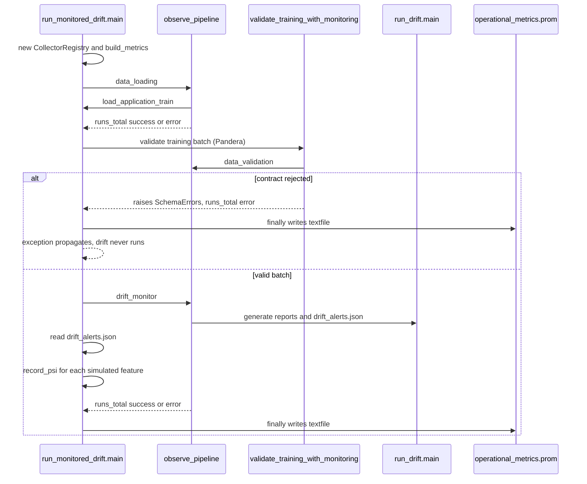

# Drift Simulation, Detection & Score Impact

The repository demonstrates data drift as a three-step, artificial stress experiment on the Home Credit "production" split. First it **simulates** drift, then it **detects** the drift with Evidently using PSI, and finally it **measures** how the trained XGBoost model's scores and decisions move. A fourth entrypoint wraps validation and detection with Prometheus instrumentation. Each step is a thin `scripts/` entrypoint over reusable logic in `src/`, and they run in order as DVC stages.

Upstream data comes from [ML Pipeline & Tracking](ml_pipeline_and_tracking.md) (`prepare_data` writes `reference.parquet` and `production_base.parquet`, and `train` writes the model and threshold). Schemas are described in [Data Contracts](../concepts/data_contracts.md). Metric consumption (Prometheus, Grafana, alert rules) is in [Observability Stack](../operations/observability_stack.md).

## Pipeline at a glance

| Stage (`dvc.yaml`) | Entrypoint | Core logic | Outputs |
|---|---|---|---|
| `simulate_drift` | `scripts/simulate_home_credit_drift.py` | `src/data/simulate_drift.py` | `data/processed/production_drift.parquet` |
| `detect_drift` | `scripts/run_drift.py` | `src/pipelines/drift_monitor.py` | `reports/drift_baseline.{html,json}`, `reports/drift_simulated.{html,json}`, `reports/drift_alerts.json` |
| `score_impact` | `scripts/analyze_score_impact.py` | `src/pipelines/score_impact.py` | `reports/score_impact.json` |
| (not a DVC stage) | `scripts/run_monitored_drift.py` | `src/monitoring/` | `reports/operational_metrics.prom` |

In `dvc.yaml`, `reports/drift_alerts.json` and `reports/score_impact.json` are declared as non-cached DVC `metrics`, so `dvc metrics show` surfaces them. The `score_impact` stage depends on `models/baseline.joblib` and `models/baseline_metrics.json`. The monitored run is a manual command and is not part of `dvc repro`.

All scripts run as modules from the repository root, for example `uv run python -m scripts.run_drift`.

## 1. Drift simulation

`simulate_income_credit_drift` in `src/data/simulate_drift.py` is a pure function. It works on a deep copy, so the input frame is never mutated. It uses a seeded `numpy` generator to choose `max(1, int(len(data) * fraction))` row positions **without replacement**, then multiplies `AMT_INCOME_TOTAL` and `AMT_CREDIT` by their multipliers on only those rows. Defaults are `fraction=0.60`, `income_multiplier=1.40`, `credit_multiplier=1.30` and `seed=42`.

Validation failures raise `ValueError`:
- Either column is missing.
- The frame is empty.
- `fraction` is outside `(0, 1]`.
- Either multiplier is `<= 1`. Only upward shifts are supported.

The entrypoint `scripts/simulate_home_credit_drift.py` overrides the defaults with a harsher scenario: `fraction=0.80`, income `×1.80`, credit `×1.70`, seed `42`. It then:
1. Fails with `FileNotFoundError` if `production_base.parquet` is missing, with a hint to run the preparation pipeline first.
2. Drops `TARGET` and runs `validate_inference_batch` (Pandera) on the result, so a drifted batch that violates the inference contract is never written.
3. Writes `production_drift.parquet` (still containing `TARGET` and `SK_ID_CURR`), and prints the mean change per column.

Because row selection is seeded and IDs and targets are untouched, the drifted file contains the same customers as `production_base.parquet`. The score-impact step depends on this. The scenario is synthetic: "production" is a random split of historical data, not a later real-world batch.

## 2. Evidently detection, PSI and structured alerts

`generate_drift_report(reference, current, output)` in `src/pipelines/drift_monitor.py`:
- Monitors only `DRIFT_COLUMNS = ["AMT_INCOME_TOTAL", "AMT_CREDIT"]`.
- Rejects either frame if the monitored columns are missing or the frame is empty (`ValueError`).
- Samples `min(5000, len(df))` rows from each side with `random_state=42` (`SAMPLE_SIZE`, `RANDOM_SEED`).
- Runs an Evidently `Report` with `DataDriftPreset(columns=..., method="psi", threshold=0.2)` (`PSI_THRESHOLD`).
- Saves the HTML snapshot at `output`, and the same snapshot's JSON at `output.with_suffix(".json")`.

`extract_psi_alerts(report_path)` then reads that JSON and keeps only metrics whose `config.type` ends with `:ValueDrift`. For each it records `{psi, threshold, alert}`, where `alert = psi >= threshold`. The comparison is **inclusive**, so a PSI of exactly 0.20 alerts. If no `ValueDrift` metric is found it raises `ValueError("Nenhuma métrica de PSI encontrada no relatório.")`. That makes a changed Evidently report format fail loudly instead of reporting "no drift".

`scripts/run_drift.py` loads `reference.parquet`, `production_base.parquet` and `production_drift.parquet` from `settings.data_dir / "processed"`. It produces two scenarios:
- `baseline`: reference vs. unmodified production.
- `simulated`: reference vs. drifted production.

It prints a per-column status line and writes both into `reports/drift_alerts.json` as `{"baseline": {col: {psi, threshold, alert}}, "simulated": {...}}`.

The committed `reports/drift_alerts.json` shows the expected pattern:

| Column | Baseline PSI | Simulated PSI | Simulated alert |
|---|---:|---:|---|
| `AMT_INCOME_TOTAL` | ≈0.0020 | ≈0.6733 | true |
| `AMT_CREDIT` | ≈0.0076 | ≈0.4521 | true |

The 0.20 threshold is a demonstration value, not a calibrated rule. Alerts here are only data in a JSON file. The repository does not send external notifications or schedule the run.

## 3. Score-impact analysis

`compare_prediction_scores(production, drifted, model, threshold)` in `src/pipelines/score_impact.py` scores the **same customers** before and after drift with the **same** trained pipeline and returns `(comparison_frame, summary)`.

Guards (all `ValueError`):
- `threshold` must be strictly in `(0, 1)`.
- Neither frame may be empty.
- Both frames must contain `SK_ID_CURR`, with no nulls or duplicates.
- The two ID sets must be identical.

Mechanics:
- `TARGET` is dropped before scoring, and `src.models.baseline.score` returns `predict_proba[:, 1]`.
- The before and after score tables are joined on `SK_ID_CURR` with `validate="one_to_one"`. Row order therefore does not matter, and `test_scores_are_aligned_by_id` reverses it on purpose.
- Per customer it adds `score_delta` and `crossed_threshold`. The latter is true when "score >= threshold" differs between before and after. A decision is "positive" at `>= threshold`.

The summary has these keys: `records`, `threshold`, `mean_score_before`, `mean_score_after`, `mean_absolute_change`, `share_above_threshold_before`, `share_above_threshold_after`, `changed_decisions` and `changed_decisions_pct`.

`scripts/analyze_score_impact.py` loads the saved model with `load_model()` and the decision threshold with `load_threshold()` (the `threshold` key of `models/baseline_metrics.json`, written at training time). It discards the per-customer frame and writes only the summary to `reports/score_impact.json`. The committed report shows 92,254 records, threshold ≈0.1410, mean score ≈0.0806 → ≈0.0755, and 4,440 changed decisions (≈4.81%).

The result measures a change in model behaviour. It does not prove a loss of predictive quality, because the experiment has no new labels and makes no causal claim. The README's narrative tables may lag the regenerated JSON, so treat `reports/*.json` as the source of truth for the numbers.

## 4. Monitored run and Prometheus export

`scripts/run_monitored_drift.py` composes loading, Pandera validation and drift detection under metrics from `src/monitoring/metrics.py`. That module defines three metrics:
- Counter `credit_pipeline_runs_total{pipeline,status}`.
- Histogram `credit_pipeline_duration_seconds{pipeline}`.
- Gauge `credit_data_drift_psi{feature}`.

`observe_pipeline(name, metrics)` is a context manager that always increments the counter and observes the duration in its own `finally`. It labels the status `success`, or `error` if an exception propagates (it then re-raises). `record_psi` rejects non-finite or negative PSI with `ValueError`.

`main()` creates a **fresh `CollectorRegistry`** (not the global one), sets the output to `REPORT_DIR / "operational_metrics.prom"`, and runs three instrumented steps inside a `try`. A `finally` block always creates the directory and calls `write_to_textfile`.



Caption: control flow of `run_monitored_drift.py`. The `finally` block writes the `.prom` file on success and on any exception, and a rejected batch blocks the drift step.

Behaviours that matter:
- **Metrics are written on every outcome.** If loading, validation or drift raises, the exception still propagates after `finally` writes the file, so a failed run leaves counters with `status="error"`. The success summary lines are printed only on the success path.
- **Invalid data blocks drift.** `validate_training_with_monitoring` (in `src/monitoring/validation.py`) runs `validate_training_batch` inside `observe_pipeline("data_validation")`. A `SchemaError`/`SchemaErrors` is logged as `status=rejected`, but the run counter records `status=error`. The exception is re-raised, so the `drift_monitor` step never executes and its series are absent from the file.
- **PSI export is scenario-specific.** Only the `simulated` block of `drift_alerts.json` is exported as gauges. The baseline PSI is not exported, and the Gauge holds the latest value per feature.
- **The monitored run calls `run_drift.main()` in-process.** It therefore re-generates the Evidently reports and `drift_alerts.json` each time. It also reads the monitored data from `load_application_train()`, which is the raw training table, for validation only.
- **Downstream.** The Node Exporter textfile collector reads `reports/`. Prometheus rule `CreditScoringDataDrift` fires on `credit_data_drift_psi >= 0.20` for 30s, with one alert per feature, in `infra/observability/prometheus/alerts.yml`. The Grafana dashboard plots the same gauge. See [Observability Stack](../operations/observability_stack.md).

## Operating it

```bash
uv run python -m scripts.simulate_home_credit_drift
uv run python -m scripts.run_drift
uv run python -m scripts.analyze_score_impact
uv run python -m scripts.run_monitored_drift   # also writes reports/operational_metrics.prom
# or the DAG as a whole
uv run dvc repro
```

Prerequisites are the prepared parquet files (`reference.parquet`, `production_base.parquet`) and a trained `models/baseline.joblib` plus `baseline_metrics.json`. Large HTML reports are regenerable and better kept out of version control. The JSON outputs are the compact evidence.

## Extension points and cautions

- **More monitored features:** extend `DRIFT_COLUMNS` in `drift_monitor.py`. The columns must also exist in `reference` and `production`. `run_monitored_drift` will export any feature in the `simulated` block automatically.
- **Different drift scenario:** change the arguments passed in `scripts/simulate_home_credit_drift.py`, or extend `simulate_income_credit_drift`. It currently only scales two columns upward.
- **Threshold:** `PSI_THRESHOLD` (0.2) in Python and the `0.20` literal in `alerts.yml` are separate copies that must be changed together. The score threshold is not configured here and comes from training metrics.
- **Evidently upgrades:** `extract_psi_alerts` depends on the JSON layout (`metrics[].config.type` ending in `:ValueDrift`, `config.column`, `config.threshold`, `value`).
- Related governance context is in [Governance & LGPD](../concepts/governance_and_lgpd.md).

## Tests

Unit tests are described in [Test Suite & CI](../testing/test_suite_and_ci.md). The focused ones for this workflow:
- `tests/unit/test_drift.py` checks that exactly the expected rows are scaled (12 of 20 at the default 0.60), that `SK_ID_CURR` and `TARGET` are untouched, that the result still passes `validate_training_batch`, that the same seed gives identical output without mutating the input, and that invalid `fraction` values (0, negative, >1) are rejected.
- `tests/unit/test_drift_monitor.py` parametrizes PSI 0.05, 0.20 and 0.35 (the boundary alerts) and checks that a report with no metrics is rejected.
- `tests/unit/test_score_impact.py` uses a fake model (so no XGBoost training) to check ID alignment under reordering, and rejection of mismatched IDs, duplicated IDs and an out-of-range threshold.
- `tests/unit/test_run_monitored_drift.py` monkeypatches `REPORT_DIR`, the loader and `run_drift_main`. It checks that the success, drift-failure and invalid-batch paths each still produce the `.prom` file with the correct `success`/`error` counters. It also checks that the exported PSI gauge appears, and that an invalid batch (`AMT_CREDIT = 0`) raises `SchemaErrors` and never calls drift.
