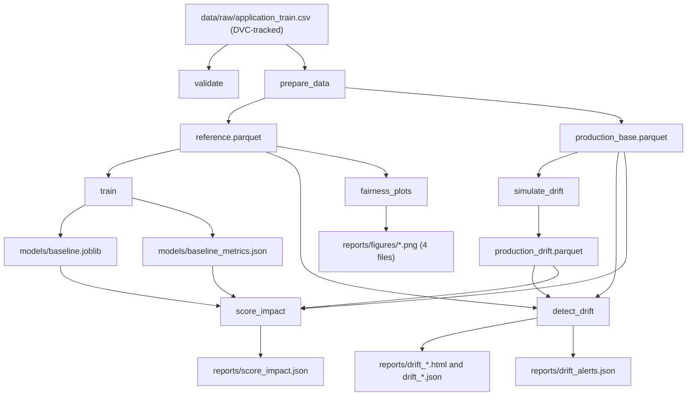

# ML Pipeline, DVC Stages & Experiment Tracking

The project trains a baseline credit-scoring model (default probability, "PD") on the Kaggle Home Credit `application_train.csv`. The workflow is declared as a DVC pipeline in [`dvc.yaml`](../../dvc.yaml) and run with `uv run dvc repro`. Each stage shells out to a Python module through `uv run python -m ...`. The first three stages (`validate`, `prepare_data`, `train`) build the model. The next three (`simulate_drift`, `detect_drift`, `score_impact`) are covered in [Drift Monitoring & Score Impact](drift_monitoring_and_score_impact.md) and are only summarised here. The seventh stage, `fairness_plots`, is a leaf stage that retrains the baseline in-process and draws per-group fairness figures (see [Fairness plots](#fairness-plots-fairness_plots)).

## DVC stage dependency graph

*Figure 1: Data and artifact dependencies between DVC stages, as declared in `dvc.yaml`.*

| Stage | Command module | Key outputs |
| :--- | :--- | :--- |
| `validate` | `scripts.validate_home_credit` | none (acts as a gate and has no downstream artifact edge) |
| `prepare_data` | `src.pipelines.prepare_data` | `data/processed/reference.parquet`, `data/processed/production_base.parquet` |
| `train` | `src.training.train` | `models/baseline.joblib`, `models/baseline_metrics.json` (metrics) |
| `simulate_drift` | `scripts.simulate_home_credit_drift` | `data/processed/production_drift.parquet` |
| `detect_drift` | `scripts.run_drift` | `reports/drift_baseline.html`, `reports/drift_simulated.html`, `reports/drift_baseline.json`, `reports/drift_simulated.json`, `reports/drift_alerts.json` |
| `score_impact` | `scripts.analyze_score_impact` | `reports/score_impact.json` |
| `fairness_plots` | `scripts.generate_fairness_plots` | `reports/figures/roc_by_gender.png`, `roc_by_age.png`, `error_rates_by_gender.png`, `error_rates_by_age.png` |

Operational notes:

- **Stage invalidation is dependency-driven.** `train` depends on `src/features`, `src/models` and `src/training` as whole directories, plus `reference.parquet`. Editing any file in those packages re-runs training and, transitively, `score_impact`. `validate`, `prepare_data` and `simulate_drift` all depend on `src/data`.
- **`cache: false` outputs.** Small, human-diffable JSON files are declared with `cache: false`, so DVC leaves them out of its cache and Git can track them directly. These are `models/baseline_metrics.json` (a `metrics` entry of `train`), `reports/drift_baseline.json` and `reports/drift_simulated.json` (plain `outs` of `detect_drift`), and `reports/drift_alerts.json` and `reports/score_impact.json` (`metrics` entries). The four fairness PNGs of `fairness_plots` are also `cache: false`. Parquet files, `baseline.joblib` and the HTML drift reports use the default cached behaviour.
- **`fairness_plots` depends on `src/training/train.py`.** It lists that single file (not the whole `src/training` directory), plus `reference.parquet`, its script and `src/visualization/fairness_plots.py`. It does not depend on `models/baseline.joblib`, so it is ordered independently of `train` and no stage consumes its output.
- **`dvc.lock` lags the new stage.** The committed [`dvc.lock`](../../dvc.lock) contains no `fairness_plots` entry, so the first `dvc repro` after this change will run that stage and add one.
- **Raw data is pinned by hash.** [`data/raw/application_train.csv.dvc`](../../data/raw/application_train.csv.dvc) records the md5 of the raw CSV. [`dvc.lock`](../../dvc.lock) records md5 and size for every dependency and output of every stage, which makes a rerun with unchanged inputs a no-op.
- **`score_impact` also depends on `baseline_metrics.json`.** It needs the saved decision threshold as well as the model file.

## Data preparation (`prepare_data`)

[`src/pipelines/prepare_data.py`](../../src/pipelines/prepare_data.py) implements `run(production_size=0.3)`:

1. `load_application_train()` in `src/data/home_credit.py` reads only the `RAW_COLUMNS` from `data/raw/application_train.csv`. It raises `FileNotFoundError` with the Kaggle download URL if the file is missing.
2. `validate_training_batch()` applies the Pandera training contract (see [Data Contracts](../concepts/data_contracts.md)). The check is lazy, so all violations are collected. A violation raises `SchemaErrors` and **nothing is written**, which a unit test asserts by checking that `data/processed` does not exist.
3. `split_reference_production()` makes a stratified split on `TARGET` with `settings.random_seed`. 70% becomes the **reference** set (used for training and as the drift baseline) and 30% becomes the **production** set. Both keep their original row order.
4. Both files are written as Parquet under `data/processed/`.

The persisted columns are raw. Feature engineering is deliberately not applied at this point. It lives inside the model pipeline, so simulated changes to raw production columns such as income flow into the derived ratios at scoring time.

The standalone `validate` stage runs [`scripts/validate_home_credit.py`](../../scripts/validate_home_credit.py), which loads only the contract columns and calls `validate_training_batch()`. It has no `outs`, so a validation failure fails `dvc repro`, but no later stage reads anything from it.

## Feature engineering

[`src/features/build.py`](../../src/features/build.py) holds the column lists and `build_features()`:

- `CATEGORICAL` has 8 columns, such as `NAME_INCOME_TYPE` and `OCCUPATION_TYPE`. `NUMERIC_RAW` has 15 columns, including the `EXT_SOURCE_*` scores and the `AMT_*` and `DAYS_*` columns.
- `DERIVED` has five columns: `AGE_YEARS` (from `DAYS_BIRTH`), `CREDIT_INCOME_RATIO`, `ANNUITY_INCOME_RATIO`, `CREDIT_TERM` and `EMPLOYED_RATIO`.
- `MODEL_FEATURES = CATEGORICAL + NUMERIC` is the exact output schema of `build_features()`.
- `build_features()` is a **pure, stateless** function. It replaces the `DAYS_EMPLOYED` sentinel `365243` with `NaN`, computes the derived columns, and converts `±inf` in the derived columns to `NaN`. This makes division by zero safe. It is therefore safe to apply identically at training and inference.
- `CODE_GENDER` (`GENDER`), `SK_ID_CURR` and `TARGET` are not model features. Gender is kept in the raw data only for bias analysis, and a test asserts it never reaches the booster.

## Baseline model

[`src/models/baseline.py`](../../src/models/baseline.py) builds one scikit-learn `Pipeline` that accepts the **raw** DataFrame:

1. `FunctionTransformer(build_features)`.
2. A `ColumnTransformer` with an `OrdinalEncoder` for categoricals and passthrough for numerics. Unknown or missing categories become `NaN` (`handle_unknown="use_encoded_value"`), so unseen production categories do not break scoring. XGBoost handles `NaN` natively.
3. `XGBClassifier(**XGB_PARAMS, random_state=seed)`, with `n_estimators=400`, `max_depth=4`, `learning_rate=0.05`, `subsample=0.8`, `colsample_bytree=0.8`, `min_child_weight=5` and `eval_metric="auc"`.

The module also owns the persistence and inference helpers used by later stages:

- `save_model(pipeline, metrics)` writes `models/baseline.joblib` and `models/baseline_metrics.json` under `settings.models_dir`.
- `load_model()` and `load_threshold()` read them back. The decision threshold is the `threshold` key in the metrics file.
- `score(raw, model=None)` returns `predict_proba[:, 1]` as a Series named `score`, indexed like the input. A `TARGET` column is ignored if present.

## Training and evaluation (`train`)

[`src/training/train.py`](../../src/training/train.py) separates a reusable `train(reference)` function from the `main()` entrypoint, so that other code (notably the fairness plot script) can retrain without touching MLflow or disk.

`train(reference)`:

1. Splits `reference` into features (everything except `TARGET`) and label, and holds out a stratified 20% validation split (`test_size=0.2`, `random_state=settings.random_seed`); the other 80% fits the pipeline from `build_pipeline()`.
2. Scores the hold-out with `predict_proba(...)[:, 1]`.
3. `evaluate()` computes `auc`, `ks` (max of TPR minus FPR), `pr_auc`, `threshold`, `f1` and, at that threshold, `fpr`, `fnr` and `recall`. The threshold is the score that maximises F1 on the precision/recall curve (`best_f1_threshold()`), chosen because the positive class is rare.
4. `fairness_metrics()` applies the same threshold to the hold-out and returns, per gender (`F` and `M` only) and per age band (`lt30`, `30_44`, `45_59`, `60_plus`, built from `-DAYS_BIRTH / 365.25` with `AGE_BINS`/`AGE_LABELS`):
   - `auc_<group>` via `auc_by_group()`, which skips groups with fewer than `MIN_GROUP_POSITIVES = 30` positives or with only one class (keys like `auc_gender_F`, `auc_age_lt30`);
   - `fpr_`, `fnr_` and `recall_` per group via `error_rates_by_group()` (keys like `fpr_gender_F`, `recall_age_60_plus`). These are not subject to the 30-positive filter; they are computed for every non-null group.
5. Returns `(pipeline, metrics, fairness)`.

`error_rates()` derives recall, FPR and FNR from a confusion matrix with labels fixed to `[0, 1]`, returning `0.0` when a denominator is zero. `AGE_BINS`, `AGE_LABELS` and `error_rates` are also imported by the plotting module so figures and logged metrics share the same grouping.

`main()` reads `data/processed/reference.parquet`, re-validates it with `validate_training_batch()`, then runs `train()` inside an MLflow run (next section) and calls `save_model(pipeline, metrics)`.

`save_model()` dumps the overall `metrics` dict as-is into [`models/baseline_metrics.json`](../../models/baseline_metrics.json), so a fresh `train` run writes eight keys: `auc`, `ks`, `pr_auc`, `threshold`, `f1`, `fpr`, `fnr`, `recall`. The committed snapshot predates the error-rate additions and still holds only the first five (AUC about 0.766, threshold about 0.141); it will gain the extra keys on the next `train` run. The per-group fairness metrics go to MLflow only, not to this file.

## MLflow experiment tracking

Inside `main()`, MLflow is configured and used like this:

- `mlflow.set_tracking_uri(settings.mlflow_tracking_uri)`. The default is `sqlite:///<repo>/mlflow.db`, and `.env.example` uses `sqlite:///mlflow.db`. `mlflow.db` is git-ignored and docker-ignored.
- `mlflow.set_experiment("credit-scoring-baseline")` and a run named `baseline-xgboost`.
- `log_params`: all `XGB_PARAMS` plus `n_rows`.
- `log_metrics`: the overall metrics (including `fpr`, `fnr`, `recall`) merged with the per-group fairness metrics (AUC, FPR, FNR, recall by gender and age band).
- `mlflow.sklearn.log_model(pipeline, name="model", serialization_format="cloudpickle")`.

MLflow's copy of the model is a tracked run artifact. The file that downstream stages actually load is the separate `models/baseline.joblib` written by `save_model()` (inside the same run context). That file and the metrics JSON are the DVC-tracked outputs. MLflow is not a DVC dependency, so re-running `train` always creates a new MLflow run.

Settings come from [`src/utils/config.py`](../../src/utils/config.py) (`Settings`, `.env` loading): `random_seed=42`, `data_dir=<repo>/data`, `models_dir=<repo>/models`, `mlflow_tracking_uri`, `log_level`. See [Configuration & Environment](../concepts/configuration_and_environment.md).

## Fairness plots (`fairness_plots`)

[`scripts/generate_fairness_plots.py`](../../scripts/generate_fairness_plots.py) is both a standalone command (`uv run python -m scripts.generate_fairness_plots`) and the last DVC stage, so it runs under `dvc repro` and can also be invoked on its own. It is an optional reporting step: nothing downstream depends on it.

Flow:

1. Raises `FileNotFoundError` ("run the preparation pipeline first") if `data/processed/reference.parquet` is missing; it does not validate the data.
2. Calls `train()` from `src/training/train.py` on the reference data. This retrains the model in memory: it does **not** load `models/baseline.joblib`, does not call `save_model()` and does not log to MLflow, so it leaves no tracked run and no model files.
3. Re-creates the identical stratified 20% hold-out (same `train_test_split` arguments and seed, duplicated inline in the script) to get `x_val`, `y_val` and scores from the freshly trained pipeline. If the split in `train()` changes, the script must be changed in step.
4. Uses `metrics["threshold"]` as the decision cut and calls the two plotting functions in [`src/visualization/fairness_plots.py`](../../src/visualization/fairness_plots.py) for gender (`CODE_GENDER`, `F`/`M` only) and age (`DAYS_BIRTH` binned with `AGE_BINS`): `plot_roc_by_group()` (ROC curve per group plus a dashed overall curve with AUC in the legend; groups with a single class are skipped) and `plot_error_rates_by_group()` (grouped bars of FPR, FNR and recall per group at the threshold, via `error_rates()`).
5. Writes `roc_by_gender.png`, `roc_by_age.png`, `error_rates_by_gender.png` and `error_rates_by_age.png` into `reports/figures/` (created on demand, 150 dpi, matplotlib `Agg` backend), then prints the threshold, overall AUC/FPR/FNR/recall and the per-group metrics.

Because the stage depends on `src/training/train.py`, `src/visualization/fairness_plots.py`, the script and `reference.parquet`, editing training code invalidates the figures. The PNGs are `cache: false` outputs and are git-ignored (regenerable). See [Governance & LGPD](../concepts/governance_and_lgpd.md) for how the figures are used in bias analysis.

## Model card

[`docs/model_card.md`](../../docs/model_card.md) is a template that lists nine headings in Portuguese: model details, intended use, factors, metrics, evaluation data, training data, quantitative analysis (including fairness), ethical considerations, and limitations and recommendations. It has no content of its own yet. The fairness AUCs logged by `train` are the intended input for section 7.

## Entrypoint note

[`src/main.py`](../../src/main.py) is only a placeholder. Its `main()` prints a message and does not run the pipeline. Pipeline execution goes through `dvc repro` or the individual `python -m` modules above. Coverage is configured in `pyproject.toml` with `source = ["src"]` and `omit = ["src/main.py"]`.

## Tests

Unit tests under `tests/unit/` cover this workflow:

- `test_features.py`: output columns equal `MODEL_FEATURES`, the sentinel becomes null, the ratios are correct, income changes propagate to the ratios, and division by zero gives `NaN`.
- `test_prepare_data.py`: reference and production are disjoint with a matching target rate, invalid data blocks output, and a missing CSV gives a clear error.
- `test_baseline.py`: AUC and KS sanity checks, error-rate metrics (`fpr`/`fnr`/`recall`) in `evaluate()`, `error_rates()` on hand-computed and perfect cases, per-group AUC/FPR/FNR/recall keys, small groups skipped, unknown categories do not break scoring, gender is not a model feature, and a joblib save/load round trip preserves scores and threshold. The plotting module has no dedicated unit test.

See [Test Suite & CI](../testing/test_suite_and_ci.md) and [Architecture Overview](../architecture/overview.md) for the wider context, and [Quality Standards](development_and_quality.md) for lint and complexity gates.
