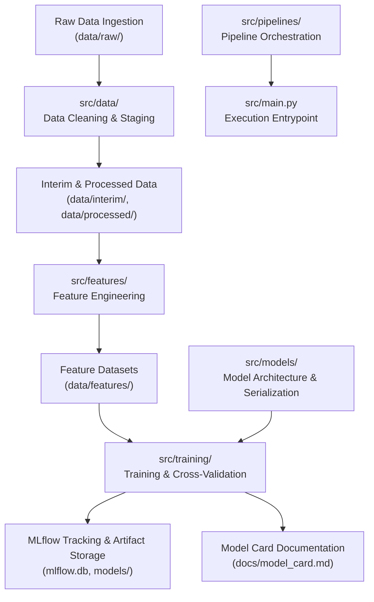

# ML Pipeline Structure & Experiment Tracking

The repository implements a structured, modular pipeline architecture for machine learning workflows. The machine learning lifecycle is organized across dedicated Python subpackages under [`src/`](../../src/), establishing clean architectural boundaries between raw data ingestion, feature engineering, model definition, training execution, experiment tracking, and pipeline orchestration.

Experiment tracking and model artifact persistence are integrated via [MLflow](https://mlflow.org/), while model governance and quantitative evaluation standards follow the structured Model Card framework defined in [`docs/model_card.md`](../../docs/model_card.md).

---

## Subpackage Responsibilities & Data Progression

The end-to-end machine learning workflow progresses sequentially through dedicated subpackages within [`src/`](../../src/). Each stage in the processing chain transforms input data or models and passes intermediate artifacts to subsequent stages.


*Figure 1: End-to-end machine learning data progression, package modularity, MLflow logging, and documentation workflow.*

### Stage-by-Stage Progression

1. **Data Staging ([`src/data/`](../../src/data/))**:
   - Handles raw data ingestion, schema validation, data cleaning, and partitioning.
   - Operates across progressive directory stages: [`data/raw/`](../../data/raw/) for immutable source datasets, [`data/interim/`](../../data/interim/) for intermediate cleaned files, and [`data/processed/`](../../data/processed/) for canonical split datasets.

2. **Feature Engineering ([`src/features/`](../../src/features/))**:
   - Constructs engineered features, applies transformations (e.g., scaling, encodings, aggregations), and manages feature extraction pipelines.
   - Persists transformed feature sets and matrices into [`data/features/`](../../data/features/).

3. **Model Definitions ([`src/models/`](../../src/models/))**:
   - Defines estimator architectures, custom model classes, neural network modules, and prediction interface wrappers.
   - Manages model serialization and deserialization routines targeting [`models/`](../../models/).

4. **Training & Evaluation ([`src/training/`](../../src/training/))**:
   - Coordinates model training, hyperparameter tuning, cross-validation, and metric computation.
   - Integrates directly with MLflow to log training parameters, performance metrics, and model checkpoints.

5. **Pipeline Orchestration ([`src/pipelines/`](../../src/pipelines/))**:
   - Composes modular components from `data`, `features`, `models`, and `training` into repeatable, end-to-end pipeline workflows.
   - Executed via top-level entrypoints such as `main()` in [`src/main.py`](../../src/main.py).

---

## Experiment Tracking with MLflow

Experiment tracking is centralized through MLflow to guarantee full experiment reproducibility, hyperparameter auditing, and model lineage.

### MLflow Backend Configuration

MLflow configuration settings are managed via Pydantic Settings in [`src/utils/config.py`](../../src/utils/config.py):

```python
class Settings(BaseSettings):
    """Variáveis de ambiente do projeto."""

    model_config = SettingsConfigDict(env_file=ROOT_DIR / ".env", extra="ignore")

    env: str = "local"
    log_level: str = "INFO"
    random_seed: int = 42
    mlflow_tracking_uri: str = f"sqlite:///{ROOT_DIR / 'mlflow.db'}"
    data_dir: Path = ROOT_DIR / "data"
    models_dir: Path = ROOT_DIR / "models"
```

- **Tracking Database URI (`mlflow_tracking_uri`)**: Defaults to `sqlite:///{ROOT_DIR}/mlflow.db`, utilizing a local SQLite database at the repository root for offline tracking during development. This URI can be overridden in `.env` or container environments to point to a remote MLflow tracking server (e.g., PostgreSQL or HTTP server).
- **Reproducibility Seed (`random_seed`)**: Set to `42` by default to ensure deterministic pseudo-random seed initialization across data splits, feature transformations, and model training routines.

### Logged Artifacts & Metrics

During training runs orchestrated by [`src/training/`](../../src/training/), MLflow records:
- **Parameters**: Training hyperparameters, feature flags, data split ratios, and random seed initializations.
- **Metrics**: Quantitative evaluation performance across training, validation, and test datasets (e.g., accuracy, precision, recall, F1-score, RMSE, ROC-AUC).
- **Model Checkpoints**: Model binaries and serialized pipeline transformers logged to [`models/`](../../models/) (`settings.models_dir`).

---

## Model Card Governance & Evaluation Standards

Model governance and ethical reporting standards are governed by the Model Card specification defined in [`docs/model_card.md`](../../docs/model_card.md). Every trained model candidate intended for production deployment must include or update a Model Card covering nine required sections:

| Section Number | Section Title | Description & Reporting Requirements |
| :--- | :--- | :--- |
| **1** | **Detalhes do modelo** (Model Details) | Model architecture type, version, release date, core maintainers, and license information. |
| **2** | **Uso pretendido** (Intended Use) | Target application domains, primary use cases, out-of-scope scenarios, and target user demographics. |
| **3** | **Fatores** (Factors) | Relevant demographic, environmental, or operational factors that may influence model performance. |
| **4** | **Métricas** (Metrics) | Primary evaluation metrics, decision thresholds, and loss functions optimized during training. |
| **5** | **Dados de avaliação** (Evaluation Data) | Dataset sources, slice definitions, sample sizes, and preprocessing applied specifically to evaluation splits. |
| **6** | **Dados de treino** (Training Data) | Historical dataset sources, volume, temporal scope, and filtering rules applied during model training. |
| **7** | **Análise quantitativa** (Quantitative Analysis) | Performance disaggregation across subgroup slices, including bias and fairness evaluations. |
| **8** | **Considerações éticas** (Ethical Considerations) | Potential ethical risks, privacy concerns, mitigation strategies, and human oversight recommendations. |
| **9** | **Limitações e recomendações** (Limitations & Recommendations) | Known boundary conditions, performance degradation scenarios, and usage guidelines for downstream operators. |

---

## Entrypoint & Pipeline Execution

Pipeline runs are initiated through [`src/main.py`](../../src/main.py), which serves as the top-level execution entrypoint.

```python
def main() -> None:
    """Executa o pipeline principal."""
    print("Projeto inicializado com sucesso.")


if __name__ == "__main__":
    main()
```

Executing `python src/main.py` initializes configuration parameters from `src.utils.config.settings` and triggers end-to-end pipeline orchestration routines defined in [`src/pipelines/`](../../src/pipelines/).

---

## Testing & Quality Assurance Integration

Machine learning pipeline components are verified through the test suite under `tests/`.

- **Unit Testing**: Tests individual modular functions in `src/data/`, `src/features/`, and `src/models/` in isolation.
- **Integration Testing**: Verifies multi-stage data transformations and end-to-end training runs in `tests/integration/`.
- **Coverage Configuration**: Tracked in `pyproject.toml` with `source = ["src"]` while explicitly omitting top-level execution scripts (`omit = ["src/main.py"]`):

```toml
[tool.coverage.run]
source = ["src"]
omit = ["src/main.py"]
```

For comprehensive details on test execution, markers, and CI quality gates, consult [Test Suite & CI Pipelines](../testing/test_suite_and_ci.md).

---

## Related Documentation & Further Reading

- [System Architecture & ML Pipeline Design](../architecture/overview.md) – Architectural component overview and high-level system boundaries.
- [Environment Configuration & Settings Management](../concepts/configuration_and_environment.md) – Pydantic Settings, `.env` loading hierarchy, and path resolution logic.
- [Quality Standards & Notebook Hygiene](development_and_quality.md) – Ruff linting/formatting rules, Radon/Xenon complexity gates, and notebook clean state checks.
- [Test Suite & CI Pipelines](../testing/test_suite_and_ci.md) – Pytest runner options, test markers, coverage reports, and CI pipeline setup.
- [Model Card Specification Standard](../../docs/model_card.md) – Repository template and section requirements for model cards.
